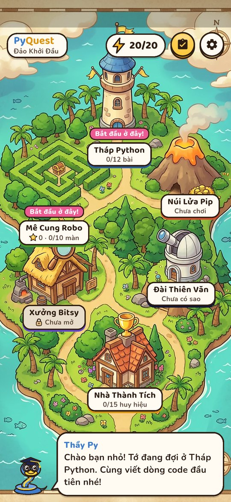
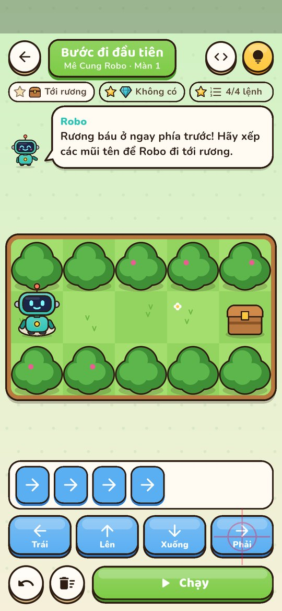
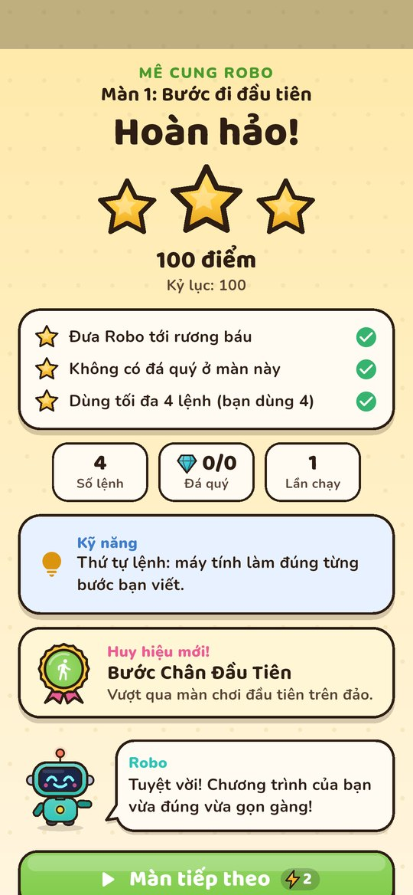
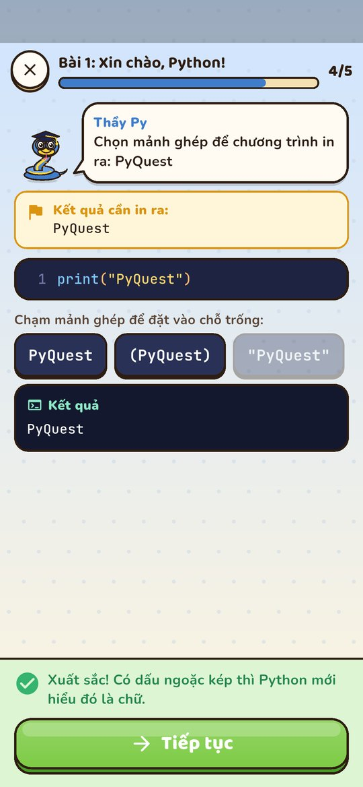
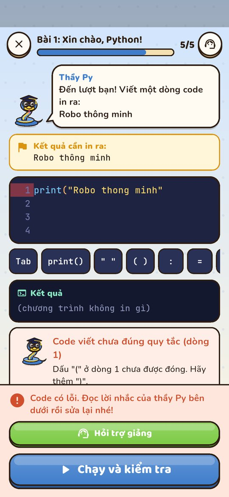
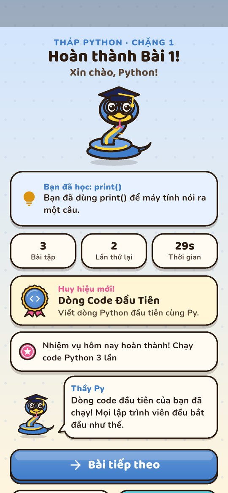
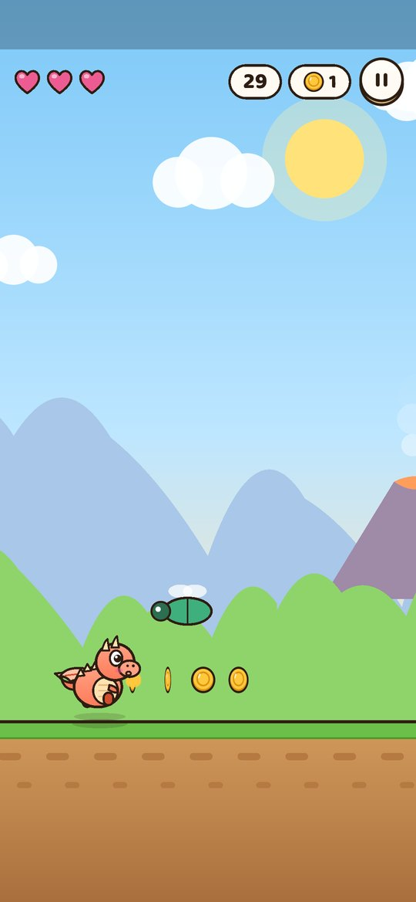
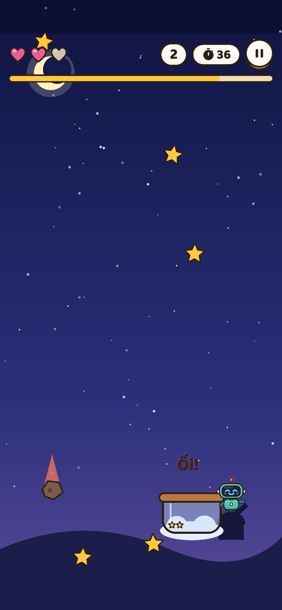
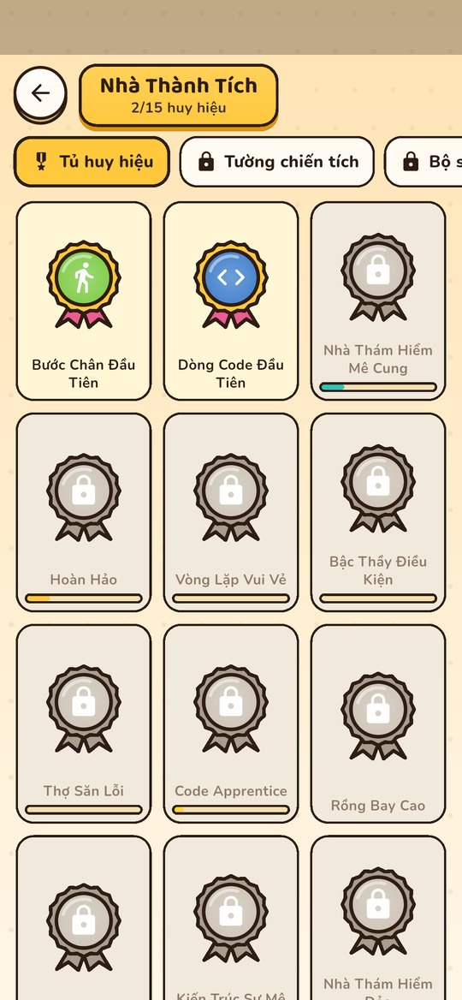

# PyQuest

**Build Your Game. Rule Your World.**

**Một thế giới game chung, gồm nhiều nhánh hoạt động độc lập** dành cho trẻ dưới
12 tuổi. Trẻ chọn kiểu trải nghiệm mình thích — phiêu lưu, khám phá, sưu tầm,
giải đố, sáng tạo, thi đấu hoặc chơi cùng bạn bè. **Lập trình Python là một nhánh
mạnh của PyQuest, không phải yêu cầu bắt buộc cho mọi trò chơi.**

> Trẻ mở PyQuest vì thích chơi, ở lại vì tò mò, rồi tự hỏi:
> *"Mình có thể tự làm một game như thế này không?"*
> Đó là lúc PyQuest mở thêm nhánh sáng tạo — nơi trẻ học cách tự tạo ra
> trò chơi của riêng mình.

---

## Trạng thái dự án

**Giai đoạn:** Bản chơi được đầu tiên — **v0.1 "Đảo Khởi Đầu"** (chưa phát hành).
**Repository:** Private.
**Nền tảng:** Flutter 3.47 · Android trước (đã chạy trên Android emulator trong CI), kiến trúc giữ tương thích iOS.

Mã nguồn ứng dụng nằm trong [`app/`](app/). Mô tả những gì đã có ở mục
[Bản dựng hiện tại](#bản-dựng-hiện-tại--v01-đảo-khởi-đầu).

---

## PyQuest là gì?

- **Thế giới game chung** với bản đồ, nhân vật, thú cưng, kho báu và nhiệm vụ.
- **Nhiều nhánh hoạt động độc lập** — phiêu lưu/khám phá, sưu tầm, giải đố,
  sáng tạo, thi đấu; mỗi nhánh có luật chơi, tiến trình và phần thưởng riêng.
- **Một nhánh học lập trình Python** (Main Quest) từ `print()` đến tự xây game
  hoàn chỉnh — là điểm mạnh của PyQuest, nhưng không bắt buộc để chơi trò khác.
- **Sân chơi sáng tạo** — mỗi mini-game có Play Mode để chơi ngay; những game
  phù hợp có thêm Creator Mode để trẻ thay đổi luật chơi, dần chuyển sang viết code.

---

## Nguyên tắc thiết kế

1. **Main Map là hub điều hướng miễn phí, đầy đủ hoạt động cốt lõi** — không khóa sau paywall.
2. **Side Maps bán chiều sâu**, không bán lại kiến thức cơ bản.
3. **Năng lượng là tài nguyên gameplay thực sự**, không phải thanh trang trí.
4. **Quảng cáo thưởng tự nguyện** — không bắt buộc để học kiến thức cơ bản.
5. **Nghỉ ngơi là một phần của game** — có hoạt ảnh, gợi ý vận động mắt.
6. **Không gây áp lực mua Pro** — không đánh lừa, không tạo áp lực với trẻ.
7. **Tuân thủ chính sách trẻ em** — kiểm tra Google Play Families và
   mạng quảng cáo trước khi chốt cơ chế.
8. **Python phải thật hoặc mô phỏng giới hạn rõ ràng** — không tô giao diện
   giống trình soạn code rồi tuyên bố trẻ đã tạo game Python thật.
9. **Mỗi hoạt động độc lập, tiến trình riêng** — không có XP hay cấp độ toàn cục;
   mở khóa gắn trực tiếp với hoạt động hoặc kiến thức thực sự cần. Bạn bè và
   cộng đồng giúp chơi vui hơn, không phải điều kiện bắt buộc.

---

## Tính năng chính

- **Home Map** — thế giới khám phá với nhân vật dễ thương, thoại ngắn,
  nhạc nền du dương và phản hồi âm thanh mỗi lần chạm.
- **Main Map** — bản đồ trung tâm (hub) miễn phí để khám phá, chọn và mở hoạt
  động. Bản thân nó **không phải một game lớn**; thế giới và gameplay nằm trong
  các hoạt động mà nó dẫn tới.
- **Main Quest** — tuyến học Python có cấu trúc, miễn phí, là **một hoạt động
  nằm trong Main Map**.
- **Mini-game** — Robot Maze, Dragon Jump, Catch the Stars, Bug Hunter, Pet Lab;
  mỗi game có **Play Mode**; **một số game phù hợp** có thêm **Creator Mode**.
- **Nhà Thành Tích** (Achievement House) — căn nhà trong thế giới PyQuest trưng
  bày huy hiệu, chiến tích, bộ sưu tập và game do trẻ tự tạo.
- **Màn tổng kết & Adventure Recap** — ghi nhận thành tựu cụ thể, khích lệ
  không gây áp lực, thay đổi theo hành trình.
- **Side Maps** — bản đồ mở rộng mua từng gói: Pygame Island,
  AI Pet Trainer Isle, Bug Hunter Kingdom, Legendary Title Isles.
- **Năng lượng & quảng cáo thưởng** — điều tiết nhịp chơi, không chặn việc học.

> **Thuật ngữ quan trọng:** *Main Map* là **bản đồ trung tâm (hub điều hướng)
> miễn phí**; *Main Quest* là **tuyến học Python nằm trong đó**. Main Map không
> phải một game lớn — thế giới và gameplay nằm trong các hoạt động. Hai khái niệm
> khác nhau, không dùng thay thế.
> Định nghĩa đầy đủ ở [`docs/PRODUCT_VISION.md`](docs/PRODUCT_VISION.md).

---

## Bản dựng hiện tại — v0.1 "Đảo Khởi Đầu"

Một hòn đảo vẽ tay là **Main Map (hub)**: chạm vào từng địa điểm để mở hoạt động
riêng. Không có XP hay cấp độ toàn cục — mỗi hoạt động có luật chơi, điểm,
tài nguyên và tiến trình của riêng nó.

| Địa điểm | Hoạt động | Cần Python? | Có gì |
|---|---|---|---|
| **Tháp Python** | Main Quest | Có | Chặng 1 *Code Apprentice*: 12 bài, 64 bước (truyện, ví dụ chạy được, trắc nghiệm, ghép mảnh, xếp dòng, tự viết code, điều khiển Robo bằng code). Màn tổng kết bài, Adventure Recap, Sân tập code miễn phí. |
| **Mê Cung Robo** | Mini-game xếp lệnh | Không | 10 màn, 3 sao (tới rương · nhặt đủ đá quý · ít lệnh), khối Lặp lại, gợi ý theo số lần sai, xem code Python sinh ra. **Xưởng Mê Cung (Creator Mode):** tự vẽ mê cung, đặt luật, chứng minh giải được bằng khối lệnh hoặc code Python. |
| **Núi Lửa Pip** | Rồng Nhảy (arcade) | Không | Game loop riêng, vật lý nhảy 2 lần, chướng ngại, xu. Xu chỉ dùng trong **Tổ Rồng** (nâng cấp + mũ cho Pip). |
| **Đài Thiên Văn** | Hái Sao (arcade) | Không | Kéo bình hứng sao, combo, sao cầu vồng, né thiên thạch. Sao hái được thắp sáng **Bản đồ chòm sao** (sưu tầm). |
| **Xưởng Bitsy** | Săn Bọ Lỗi (debug) | Có | 12 câu đố, 20 con bọ; mở khi học xong Bài 3 (nút "Đi tới bài học"). |
| **Nhà Thành Tích** | Thành tích | — | 15 huy hiệu (3 bí mật), Tường chiến tích, Bộ sưu tập, Góc sáng tạo — mở dần theo hành trình. |

Hệ thống chung: năng lượng hồi theo thời gian (kể cả khi tắt app; không quảng cáo,
không mua bán), nhiệm vụ hằng ngày (3 nhiệm vụ, nhận tem, không chuỗi ngày),
nhắc nghỉ 30/45/60 phút và bài nghỉ mắt 20 giây, âm thanh/nhạc tự tạo, chế độ êm dịu,
lưu toàn bộ tiến trình bằng SQLite.

**PyQuest Python (mô phỏng)** là một tập con Python viết bằng Dart, chạy ngay trên
máy: biến, số, chuỗi, f-string, list, if/elif/else, for/while, def/return.
Có giới hạn rõ ràng (100.000 bước, 50 tầng gọi hàm, 10.000 ký tự output; không
`import`, class, dict, tuple, `input()`...). Lỗi được giải thích bằng tiếng Việt
kèm thông báo mà Python thật sẽ in. Danh sách đầy đủ hiển thị trong app
(Cài đặt → *Về PyQuest Python*).

### Ảnh chụp thật (Android emulator API 34, Pixel 6, trong CI)

| Bản đồ đảo | Mê Cung Robo | Kết quả màn |
|---|---|---|
|  |  |  |
| **Bài học Python** | **Lỗi được giải thích** | **Tổng kết bài** |
|  |  |  |
| **Rồng Nhảy** | **Hái Sao** | **Nhà Thành Tích** |
|  |  |  |

Toàn bộ ảnh (kể cả lần mở lại app để kiểm tra dữ liệu đã lưu) nằm ở
[`docs/screenshots/`](docs/screenshots/).

---

## Cấu trúc repository

```text
PyQuest/
├── README.md
├── docs/                      # Tài liệu sản phẩm + ảnh chụp màn hình
├── .github/workflows/ci.yml   # Analyze, test, render preview, build APK, emulator
├── ci/                        # Script CI (báo cáo, hành trình trên emulator)
└── app/                       # Ứng dụng Flutter
    ├── lib/
    │   ├── app/               # Khởi động, AppServices, registry các địa điểm
    │   ├── core/              # Sự kiện, cấu hình, âm thanh, cài đặt, phiên chơi
    │   ├── data/              # SQLite (migration) + repository
    │   ├── modules/           # Mỗi hoạt động một module độc lập
    │   ├── python_runtime/    # PyQuest Python (lexer, parser, interpreter)
    │   └── shared/            # Theme, nhân vật vẽ bằng code, widget dùng chung
    ├── assets/                # Bản đồ, font, âm thanh, cấu hình, nội dung (JSON)
    ├── test/                  # Unit, widget, render preview
    └── integration_test/      # Hành trình trên thiết bị thật/emulator
```

Thêm một trò chơi mới = tạo module trong `lib/modules/` + thêm một dòng vào
`lib/app/activity_registry.dart`; bản đồ, năng lượng, sự kiện, huy hiệu và lưu
trữ không cần sửa.

| Tài liệu | Vai trò |
|---|---|
| [`docs/PRODUCT_VISION.md`](docs/PRODUCT_VISION.md) | Ý tưởng sản phẩm, thế giới, nhân vật, mô hình kinh doanh, triết lý giáo dục |
| [`docs/GAME_DESIGN.md`](docs/GAME_DESIGN.md) | Luật chơi, năng lượng, mở khóa hoạt động, huy hiệu, thành tích, cân bằng độ khó |
| [`docs/TECHNICAL_ARCHITECTURE.md`](docs/TECHNICAL_ARCHITECTURE.md) | Interpreter, module, lưu dữ liệu, quảng cáo, thanh toán |
| [`docs/ROADMAP.md`](docs/ROADMAP.md) | Giai đoạn triển khai, tiêu chí nghiệm thu và kiểm thử |

**Nguyên tắc tài liệu:** tài liệu sản phẩm xác định *xây trò chơi gì*;
tài liệu kỹ thuật xác định *xây bằng cách nào*; roadmap xác định
*làm gì trước và kiểm tra bằng gì*.

---

## Roadmap tóm tắt

1. **Foundation** — khung Flutter, điều hướng, lưu dữ liệu, giao diện cơ bản.
2. **Home Map** — thế giới chính, nhân vật, âm thanh.
3. **Một mini-game hoàn chỉnh** — gameplay, điểm số, lưu kỷ lục, Creator Mode.
4. **Energy & Rewarded Ads** — năng lượng, hồi theo thời gian, quảng cáo thưởng.
5. **Interpreter mô phỏng** — thực thi tập con Python-like an toàn, giới hạn tài nguyên.
6. **Main Quest** — bài học Python, bài tập, lưu tiến trình.
7. **Side Maps & Pro** — nội dung mở rộng và mua hàng.
8. **Hoàn thiện** — localization, accessibility, kiểm thử, build, phát hành.

Chi tiết xem tại [`docs/ROADMAP.md`](docs/ROADMAP.md).

**Nguyên tắc chốt từ đầu:** đừng xây cả thế giới PyQuest ngay lập tức.
Làm một **lát cắt dọc hoàn chỉnh**:
mở app → vào một trò chơi → chơi được → lưu kết quả → thoát ra mở lại vẫn còn kết quả.
Lát cắt này **không** cần interpreter Python; interpreter được xây ở giai đoạn 5.

**Về runtime:** giai đoạn đầu dùng **interpreter mô phỏng một tập con giới hạn**
(Flutter/Dart), **không** chạy Python thật. Việc nhúng Python thật chỉ được đánh
giá sau, khi mô phỏng đã chứng minh giá trị sư phạm. Chi tiết ở
[`docs/TECHNICAL_ARCHITECTURE.md`](docs/TECHNICAL_ARCHITECTURE.md).

---

## Cách chạy

Yêu cầu: Flutter SDK stable (đã kiểm tra với 3.47.7), Android SDK hoặc thiết bị Android.

```bash
cd app
flutter pub get
flutter run                     # chạy trên thiết bị/emulator Android

flutter analyze                 # kiểm tra tĩnh
flutter test --exclude-tags render          # unit + widget test
flutter test --tags render test/render      # xuất ảnh preview vào build/previews/
flutter drive --driver=test_driver/integration_test.dart \
  --target=integration_test/journey_test.dart   # hành trình trên thiết bị, chụp màn hình
```

CI (GitHub Actions) chạy analyze + test + render preview cho mỗi lần push vào
`arena/**`; commit có `[emulator]` trong message sẽ build APK (debug + release,
tải ở mục *Artifacts* của lần chạy) và chạy hành trình trên Android emulator,
tự lưu ảnh chụp vào `docs/screenshots/`.

Mọi bước chờ trong `ci/emulator_journey.sh` đều có giới hạn thời gian (chỉnh qua
`env:` của bước *Emulator journey*). Nếu emulator mất kết nối adb, không boot
xong hoặc một bước quá hạn, script thu thập chẩn đoán rồi dừng với mã lỗi ≠ 0.

Song song mỗi `flutter drive`, `ci/check_test_progress.py` theo dõi tiến trình
test (số test đã xong, ảnh chụp mới, log của app) và **dừng ngay** nếu app bị
khởi động lại giữa chừng hoặc test không tiến triển — lý do được ghi vào
`emulator-stop-reason.txt`. Trong hành trình, mỗi bước in ra một dòng
`[PYQUEST] [<bước>] ...` và mỗi ảnh chụp có giới hạn thời gian riêng, nên log
luôn cho biết test đang ở đâu.

Bốn mốc thời gian của watchdog (chỉnh qua `env:` của bước *Emulator journey*):
`STARTUP_GRACE=240` (bỏ qua "không tiến triển" ngay sau khi một test bắt đầu,
tránh báo sai khi emulator chậm), `PRE_TEST_TIMEOUT=900` (lúc `flutter drive`
còn build/install), `PROGRESS_TIMEOUT=300` (lúc test đang chạy) và
`WATCHDOG_KILL_AFTER=20` (SIGKILL nếu drive bỏ qua SIGTERM). Watchdog không bao
giờ khởi động lại adb/emulator; nó ghi lý do rồi dừng drive.

`emulator-sampler.txt` ghi RAM/load/CPU của máy chạy mỗi 20 giây trong lúc
`flutter drive` hoạt động, còn `runner-state.txt` ghi trạng thái còn lại sau
bước emulator (đĩa, RAM, KVM, tiến trình qemu, cấu hình AVD, log của netsimd).
Hai tệp này đủ để trả lời câu hỏi "emulator biến mất vì hết RAM?" mà không cần
đọc log của runner.

**Về ảnh chụp:** `integration_test` chỉ chuyển ảnh từ app về máy chạy sau khi
**toàn bộ** kịch bản kết thúc, nên nếu app hoặc emulator chết giữa chừng thì mọi
ảnh của lượt đó đều mất (đúng như run 38797124392). Khi đó phải đọc
`emulator-progress.txt` và `journey.txt` để biết test đang ở bước nào.

Log tiến trình, chẩn đoán emulator và bản trích xuất log hệ thống
(`emulator-log-analysis.txt`: khởi động lại activity, đổi cấu hình, ANR) nằm ở
artifact `emulator-logs-attempt-N`. Muốn trích xuất lại trên máy:

```bash
gh run download <run-id> -n emulator-logs-attempt-1 -D /tmp/e
python3 ci/analyze_logcat.py /tmp/e/emulator-diagnostics/logcat_all.txt
```

---

## Đóng góp & giấy phép

Dự án đang ở giai đoạn phát triển nội bộ, chưa mở đóng góp công khai.
Giấy phép sẽ được công bố trước khi phát hành.

---

**PyQuest** — *Build Your Game. Rule Your World.*
