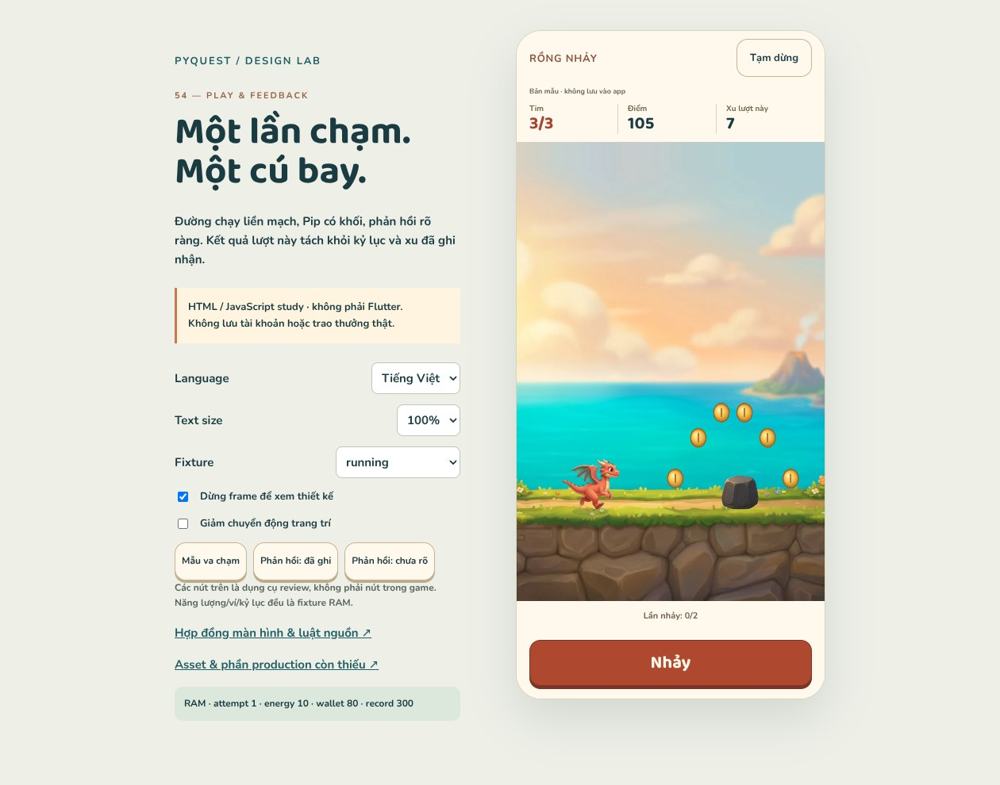
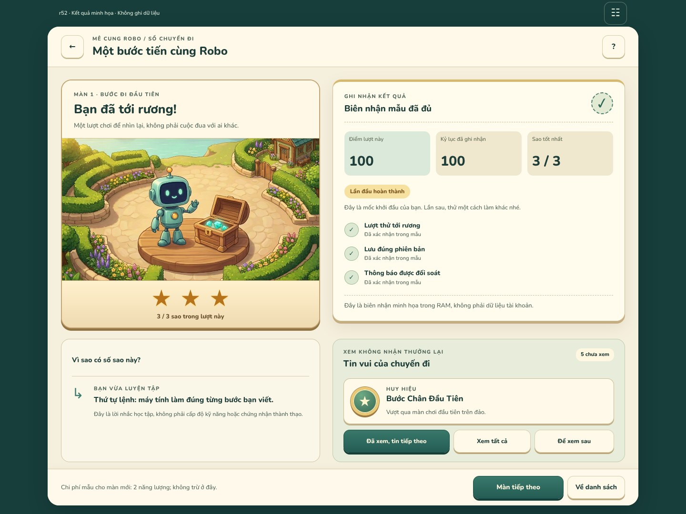

# Thiết kế hình ảnh PyQuest — tình trạng đến r55

**2026-10-18 · Chưa hoàn tất toàn bộ.** Không dùng số concept hoặc HTML PASS để
nói app đã được redesign xong. Ba mức tách riêng: concept → screen/interaction study
→ runtime art pack +after-runtime evidence.

## Mới nhất r55 — Catch Stars gameplay, kết quả và bản đồ sao

[Study/spec/art](catch-stars-r55/README.md): bốn artwork mới, jar và fallers tách
nền, Robo tái sử dụng r50. Điểm lượt khác số vật tích lũy; zero-star vẫn mở được
chòm sao. Tám chòm giữ geometry/story VI/threshold nguồn, có bản dịch EN.

32 model checks +1.000 record comparisons +10.000 spawn samples;
240 browser configs /1.236 targets /372 font checks /148 flows. Chữ thật1/1.3/2×.
**JS/RAM, không Flutter/SQLite/device/engine parity.** Camera600, keyboard/buttons,
lifecycle và receipt authority là đề xuất; jar/alpha/animation còn production gaps.
[Task PQD-016](coordination/tasks/PQD-016.md). Relay r54 chưa gửi, không chờ relay.

CODE đã push R1-A tới e440239, chưa ACCEPTED: ba workflow quan sát đều failure.
[Observation](catch-stars-r55/partner-observation.json). Không đổi quyền020 hoặc
mở Catch runtime; tiếp review020 khi có bàn giao và DESIGN R1-B độc lập.

## Đợt trước r54 — Dragon Jump gameplay và kết quả

[Study/spec/art](dragon-run-r54/README.md): đường chạy liên tục đúng luật nguồn,
Pip/rock/beetle2,5D mới; nhảy/vỗ cánh, hit/pause/finish, kết quả và receipt states.
Camera responsive không thu nhỏ actor để né chữ2×; điểm/xu/gem/record tách rõ.
30modelchecks +1.000record comparisons,192browserconfigs,300fontassertions,
99flows,16captures. **JS/RAM, không Flutter/SQLite/device/engine parity.**

Runtime Dragon chưa mở. CODE giữPQC-020/R1-A; không bị giao thêm study này.
DESIGN tiếp Catch Stars rồiR1-B. [TaskPQD-015](coordination/tasks/PQD-015.md).

## Đợt trước r53 — chuyển Main Map sang triển khai Flutter

[PQC-020](../implementation/coordination/tasks/PQC-020.md) READY_FOR_CODE trên nền
011 đãACCEPTED6dc8ca8. [R1-A study/export/spec](r1-village-r53/README.md): staticW01,
6markers nối source, directory chữ lớn, loading/error/return. 15modelchecks,
60browserconfigs/360fontchecks/108flows; không phải Flutter captures.

Lead cho phép **flattened static scene riêng R1-A**, không tự chứng nhậnlayered
pack hoặc NPC/world. CODE chưa implementation/accept, chưa APK. Các study r50–r52
vẫn có giá trị, không làm lại. DESIGN tiếp Dragon/Catch gameplay và R1-B độc lập.

## Mới nhất: kết quả và ghi nhận Mê Cung r52

**Đã giao r52:** [study tương tác](maze-result-r52/index.html),
[spec/evidence](maze-result-r52/README.md). Điểm/sao lượt này tách record;
first/better/tie/lower, skill reminder không mastery; pending/error/partial receipt,
inbox5notice kinds; custom report≠saved proof, bản sửa không nhận callback cũ.
Một illustration2,5D mới đồng bộ r50, không bake số sao vào ảnh.26model checks
+1.000record comparisons;342browser cases/3.420font assertions/18flows/12captures.
**RAM fixtures, không engine/DB/events/rewards hoặc Flutter port**; reconciliation
là contract đề xuất, không endpoint/transaction thật. [PQD-013](coordination/tasks/PQD-013.md).

## Đợt trước: Xưởng Python và phản hồi lỗi r51

**Đã giao r51:** [editor tương tác](maze-python-r51/index.html),
[spec/evidence](maze-python-r51/README.md). Gõ/chọn/chèn mã thật, undo/redo,
giữ draft qua tab, xác nhận trước ghi đè, tới dòng lỗi và loại phản hồi cũ.
Chỉ custom mazes; màn thường vẫn chỉ xem bản dịch Python. Tái dùng artwork
r46/r50, không đổi style. 29model checks+1.000random edits;252browser cases,
1.476font assertions/19flows/12captures. **Chỉ phát phản hồi authored cho exact
sample code, không chạy Python/Flutter**, không save/verified/reward hoặc bridge.
[PQD-012](coordination/tasks/PQD-012.md) không phát runtime order cho CODE.

## Đợt trước: Maze block-play và kết quả r50

**Đã giao r50:** [gameplay/kết quả tương tác](maze-play-r50/index.html),
[README/evidence](maze-play-r50/README.md). Board đúng10sourcelevels trong sân
vườn2,5D, Robo/hedge mới; xếp/chỉnh/lặp/run/pause/step/stop, lỗi giữ plan,
result1–3stars, pending/error/retry và next-level energy guards.28modelchecks
+500random programs,324browsercases/3.732fontchecks/17flows,13captures.
Scope là **block-mode interaction study**, không Python editor đầy đủ, runtime
rewards/persistence hoặc production spritepack. Không thay ảnh runtime06–11 bằng
capturebrowser để gọi là after-redesign. R45/r46 giữ snapshots độc lập, chưa có
state bridge qua trang. [Asset plan và giới hạn](maze-play-r50/ASSET_PLAN.md).

## Đợt trước: Maze Creator tương tác

**Đã giao r46:** [Xưởng Mê Cung](maze-creator-r46/index.html),
[README/evidence](maze-creator-r46/README.md). Editor grid thật với6bút, resize4/5/6,
undo, dirty-save/list/load/delete, validation và bàn thử khối lệnh JS. Hai ảnh mới;
36modelchecks +4.000propertyoperations,240browsercases/4.908fontchecks/23flows,
14captures. Baseline26–28 đã có interactionstudy riêng, không còn dùngB02prose
hoặc diagramr45 để thay Creator. Kho/proof chỉ là mẫuRAM, không Flutter/Python.
Artwork chưa production: sceneopaque, symbolicCSS/legacyRobo cần thay bằng pack
đồng bộ. Xem [source/proposal contract](maze-creator-r46/SPEC.md) và assetplan.

## Đợt trước: chọn màn Maze

**Đã giao r45:** [Vườn Mê Cung](maze-trail-r45/index.html),
[README/evidence](maze-trail-r45/README.md). Một scene2,5D mới,15fixtures,
10source-levels, phác đồ246ô;360browsercases/5.664fontchecks/16flows +18modelchecks
đạt trong HTML/JS. Baseline05/41 đã có study chọn màn riêng; chưa portFlutter.

**Đợt trước r43:** [Vườn học việc Main Quest](chapter-journey-r43/index.html),
[README/evidence](chapter-journey-r43/README.md),12lesson/14fixtures. Cả hai slice
bổ sung các khoảng thiếu trong [audit r41](runtime-gap-r41/README.md), không sửa
ảnh runtime hoặc biến những ảnh lịch sử thành bằng chứng after-redesign.

## Đã có và giới hạn

| Nhóm | Thiết kế đang có | Không được coi là đã xong |
|---|---|---|
| Làng / nhà / thế giới mở rộng | [16canonicalconcept r35](art-sync-r35/catalog.json), các study [r34](art-refresh-r34/index.html), [r40](art-review-r40/index.html) | Không toàn bộ room interaction, animation hay runtime layers |
| Hải đồ / travel / visit permissions | [W08r37](world-travel-r37/index.html) | Không multiplayer/presence hoặc Flutter travel đã port |
| Nhà Thành Tích | [W14r39](achievement-house-r39/index.html) | Cabinet/detail, không đủ cả4phòng |
| Nhiệm vụ hằng ngày / năng lượng | [r41](daily-energy-r41/index.html) | Fixture claim/rest, không thực thi game authority |
| Main Quest chọn chặng/bài | [r43](chapter-journey-r43/index.html) | Không LessonScreen/Tutor board đã đổi skin, không thêm playablechapter2 |
| Shared welcome/settings, pet/shop, Creator, minigame concepts | [CODE018 review r40](art-review-r40/README.md) — art scope complete | Screen studies có giới hạn; B02 prose editor không phải MazeCreator |
| Maze Creator | [r46](maze-creator-r46/index.html) — editable grid, guards, sample shelf/test | Không Python engine/DB/event, runtime verification hay production tile/actor pack |
| Chọn màn Maze | [r45](maze-trail-r45/index.html) — scene, state, level diagrams | Chưa gameplay skin/engine/editor hoặc runtime art pack |
| Bài học / bảng Tutor | [Board study](tutor-board-prototype/index.html), W13concept; runtime011review [r49](coordination/reviews/PQC-011-r49/README.md) | 011chưaaccepted; không lấy art để thay formatter/analyzer/Flutter tests |
| Maze record/notices/custom results | [r52](maze-result-r52/index.html) — result/receipt/inbox/proof study | Không backend receipt, transaction/exactly-once, reward grants hoặc Flutter port |
| Maze Python editor/diagnostics | [r51](maze-python-r51/index.html) — native text editing +authored response fixtures | Không Python execution, verified/save, custom-result transaction hay Flutter port |
| Maze block-play/result | [r50](maze-play-r50/index.html) — run/failure/result/ack/next guards | Chưa full Python mode, custom results, bestscore/reward-notice hoặc Flutter port |
| Gameplay/result khác và các entry sheets | [First-play](first-play-prototype/index.html), [result](result-adventure-prototype/index.html), [r40](art-review-r40/index.html) | Nhiều surface còn partial, chưa screen-by-screen hoàn chỉnh cùng skin |

## Thứ tự DESIGN tiếp tục (không giao CODE trùng việc)

1. **Chọn màn Maze — đã giao screen study r45**, không còn là gap thiết kế trắng.
   Runtime port vẫn chưa mở; phác đồ read-only không tính là editor.
2. **Maze Creator — đã giao editor study r46** cho baseline26–28. Grid/brush,
   resize/marker, dirty-save và test-run đã thao tác được; chỉ HTML/JS mẫu, không
   runtime port. Python/production art và các integration gates vẫn còn.
3. **Maze block-play/result đã có r50, Python editor/diagnostics có r51; record/notices/custom-result có r52.**
   Các study không thay production pack hoặc runtime integration. **Ưu tiên tiếp theo: hoàn thiện các màn partial** từ [18nhóm audit](runtime-gap-r41/coverage.json):
   gameplay Dragon/Stars và kết quả là ưu tiên tiếp; activityentry, welcome; lesson states phải
   phối hợp011để không trộn source correction với skin redesign.
4. **Splash và rà soát các surface mở rộng** còn thiếu state/interactions, rồi
   xuất runtime art pack thật: layers/alpha/pivots/footprints/hitbounds/occluders/rig.
   Mọi nhóm vẫn cần port và after-runtime captures theo work order riêng.

Không gán phần trăm hoàn thành giả khi phạm vi screen/production khác nhau.
Các links trên là nguồn cụ thể để xem, không lời hứa rằng toàn app đã triển khai.
PQC-018 không bị mở lại; CODE011 theo r49 là PINNED_SDK_EXECUTED_FAILURE và đã có
bounded correction order riêng. R50/r51/r52 không thay order đó hoặc giao thêm runtime
work. Không có taskFlutter mới trong các gói designr45/r46/r50/r51/r52. DESIGN không tự watcher/background làm việc sau khi kết thúc lượt.
