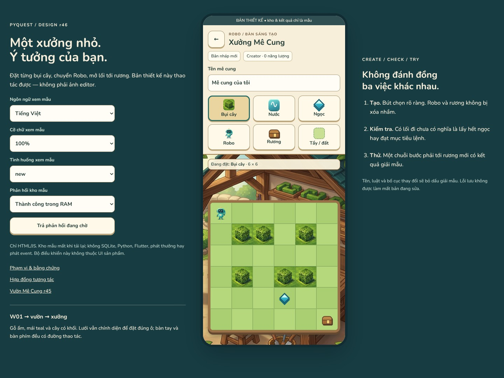
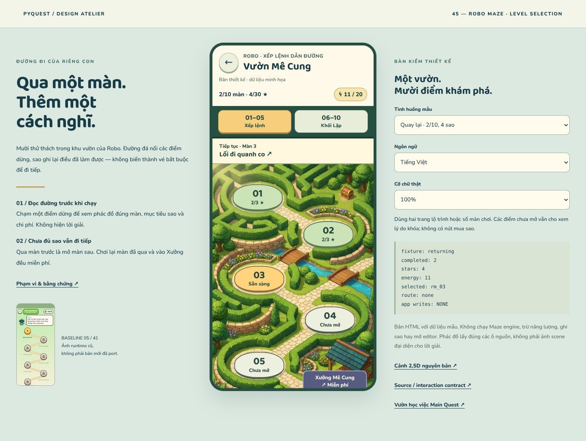

# Thiết kế hình ảnh PyQuest — tình trạng đến r46

**2026-10-18 · Chưa hoàn tất toàn bộ.** Không dùng số concept hoặc HTML PASS để
nói app đã được redesign xong. Ba mức tách riêng: concept → screen/interaction study
→ runtime art pack +after-runtime evidence.

## Mới nhất: Maze Creator tương tác

**Đã giao r46:** [Xưởng Mê Cung](maze-creator-r46/index.html),
[README/evidence](maze-creator-r46/README.md). Editor grid thật với6bút, resize4/5/6,
undo, dirty-save/list/load/delete, validation và bàn thử khối lệnh JS. Hai ảnh mới;
36modelchecks +4.000propertyoperations,240browsercases/4.908fontchecks/23flows,
14captures. Baseline26–28 đã có interactionstudy riêng, không còn dùngB02prose
hoặc diagramr45 để thay Creator. Kho/proof chỉ là mẫuRAM, không Flutter/Python.
Artwork chưa production: sceneopaque, symbolicCSS/legacyRobo cần thay bằng pack
đồng bộ. Xem [source/proposal contract](maze-creator-r46/SPEC.md) và assetplan.

## Đợt trước: chọn màn Maze

**Đã giao r45:** [Vườn Mê Cung](maze-trail-r45/index.html),
[README/evidence](maze-trail-r45/README.md). Một scene2,5D mới,15fixtures,
10source-levels, phác đồ246ô;360browsercases/5.664fontchecks/16flows +18modelchecks
đạt trong HTML/JS. Baseline05/41 đã có study chọn màn riêng; chưa portFlutter.

**Đợt trước r43:** [Vườn học việc Main Quest](chapter-journey-r43/index.html),
[README/evidence](chapter-journey-r43/README.md),12lesson/14fixtures. Cả hai slice
bổ sung các khoảng thiếu trong [audit r41](runtime-gap-r41/README.md), không sửa
ảnh runtime hoặc biến những ảnh lịch sử thành bằng chứng after-redesign.

## Đã có và giới hạn

| Nhóm | Thiết kế đang có | Không được coi là đã xong |
|---|---|---|
| Làng / nhà / thế giới mở rộng | [16canonicalconcept r35](art-sync-r35/catalog.json), các study [r34](art-refresh-r34/index.html), [r40](art-review-r40/index.html) | Không toàn bộ room interaction, animation hay runtime layers |
| Hải đồ / travel / visit permissions | [W08r37](world-travel-r37/index.html) | Không multiplayer/presence hoặc Flutter travel đã port |
| Nhà Thành Tích | [W14r39](achievement-house-r39/index.html) | Cabinet/detail, không đủ cả4phòng |
| Nhiệm vụ hằng ngày / năng lượng | [r41](daily-energy-r41/index.html) | Fixture claim/rest, không thực thi game authority |
| Main Quest chọn chặng/bài | [r43](chapter-journey-r43/index.html) | Không LessonScreen/Tutor board đã đổi skin, không thêm playablechapter2 |
| Shared welcome/settings, pet/shop, Creator, minigame concepts | [CODE018 review r40](art-review-r40/README.md) — art scope complete | Screen studies có giới hạn; B02 prose editor không phải MazeCreator |
| Maze Creator | [r46](maze-creator-r46/index.html) — editable grid, guards, sample shelf/test | Không Python engine/DB/event, runtime verification hay production tile/actor pack |
| Chọn màn Maze | [r45](maze-trail-r45/index.html) — scene, state, level diagrams | Chưa gameplay skin/engine/editor hoặc runtime art pack |
| Bài học / bảng Tutor | [Board study](tutor-board-prototype/index.html), W13concept; runtime011review [r44](coordination/reviews/PQD-003-r44.md) | 011chưaaccepted; không lấy art để thay formatter/analyzer/Flutter tests |
| Gameplay/result và các entry sheets | [First-play](first-play-prototype/index.html), [result](result-adventure-prototype/index.html), [r40](art-review-r40/index.html) | Nhiều surface còn partial, chưa screen-by-screen hoàn chỉnh cùng skin |

## Thứ tự DESIGN tiếp tục (không giao CODE trùng việc)

1. **Chọn màn Maze — đã giao screen study r45**, không còn là gap thiết kế trắng.
   Runtime port vẫn chưa mở; phác đồ read-only không tính là editor.
2. **Maze Creator — đã giao editor study r46** cho baseline26–28. Grid/brush,
   resize/marker, dirty-save và test-run đã thao tác được; chỉ HTML/JS mẫu, không
   runtime port. Python/production art và các integration gates vẫn còn.
3. **Ưu tiên tiếp theo: hoàn thiện các màn partial** từ [18nhóm audit](runtime-gap-r41/coverage.json):
   gameplay Maze/Dragon/Stars, kết quả, activityentry, welcome; lesson states phải
   phối hợp011để không trộn source correction với skin redesign.
4. **Splash và rà soát các surface mở rộng** còn thiếu state/interactions, rồi
   xuất runtime art pack thật: layers/alpha/pivots/footprints/hitbounds/occluders/rig.
   Mọi nhóm vẫn cần port và after-runtime captures theo work order riêng.

Không gán phần trăm hoàn thành giả khi phạm vi screen/production khác nhau.
Các links trên là nguồn cụ thể để xem, không lời hứa rằng toàn app đã triển khai.
PQC-018 không bị mở lại; CODE011 theo r44 đang WAITING_FOR_PINNED_SDK_EVIDENCE; không giao correction
source mới. Không có taskFlutter mới trongr45/r46. DESIGN không tự watcher/background làm việc sau khi kết thúc lượt.
