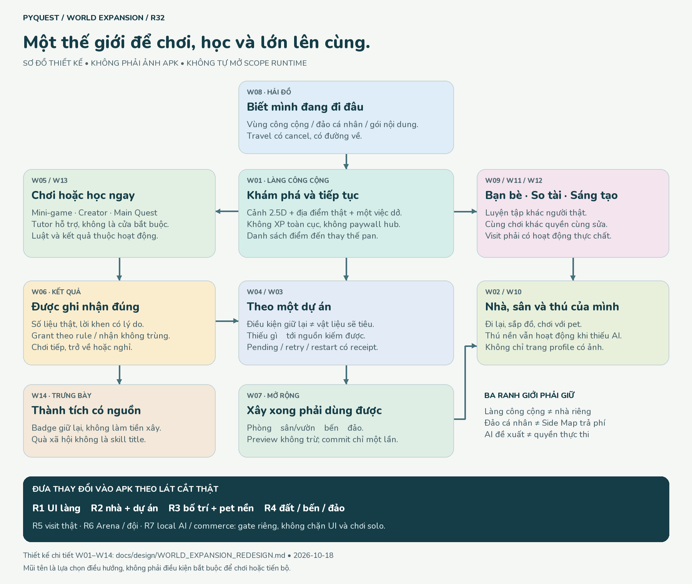

# PyQuest — Thiết kế lại thế giới theo phạm vi mở rộng

**Revision 1 · 2026-10-18 · DESIGN, chưa là UI Flutter đã triển khai.**
Nguồn runtime đối chiếu: `a9bcdcf` (APK đã build);011 được giao ở r31, chưa nghiệm thu.
Đây là thiết kế tổng thể mới để nối các gói P03–P08, không thêm một demo độc lập rồi
coi đã thay app. Bốn tài liệu gốc được đồng bộ cùng revision này.



*Sơ đồ là lựa chọn đường chơi, không phải chuỗi cổng bắt buộc. Tái tạo bằng
`python tools/design/render_world_expansion_map.py` với requirements design hiện có.*

## 1. Điều thay đổi so với thiết kế cũ

**PyQuest là nơi để chơi, học, làm ra đồ vật và xây một nơi thuộc về mình.**
Tutor quan trọng từ đầu nhưng không phải cửa bắt buộc để vào mọi trò chơi.

| Thiết kế cũ / thiếu liên kết | Quyết định mới |
|---|---|
| Một ảnh làng + sáu nhãn mở module | Một hub công cộng có khu vực rõ; tách cảnh, điểm vào, diễn viên và UI. Nhiều vùng không phải sáu thumbnail phóng to |
| P06C có hành trình tốt nhưng màn đầu là trang cuộn thẻ dài | Cảnh chơi là trung tâm; dự án đang theo là một dải gọn, chi tiết nằm trong Sổ hành trình hoặc màn dự án |
| Nhà vừa là tên module vừa là nhà người chơi | Công trình công cộng là portal; nhà riêng là không gian có owner, bố cục và quyền. Không tạo một module Flutter cho từng căn phòng |
| Huy chương/vật liệu chỉ nằm trong prototype | Luật điều kiện/chi phí/nhận thưởng/xây dựng phải có trong Game Design và architecture, không giấu trong art |
| Trang bạn bè có thiệp được gọi là thăm nhà | Trang bạn bè chỉ là lối vào; thăm nhà cần đi lại, tương tác, quyền và trạng thái chủ vắng/cùng phiên |
| Mèo đứng cạnh chat | Pet có hoạt động và đường đi; hội thoại/model là lớp bổ sung, không điều khiển kinh tế/quyền |
| Voice/AI hoàn thiện rồi mới làm UI | UI thế giới có đường triển khai riêng; không phụ thuộc hoàn tất voice/local AI hoặc backend xã hội |

## 2. Bản đồ sản phẩm và ngôn ngữ chung

```text
                       HẢI ĐỒ (W08)
             ┌─────────────┼────────────────┐
       vùng công cộng   đảo cá nhân     Side Map nội dung
       + hoạt động      + owner         + entitlement riêng
             │              │                  │
             └──── BẾN / TRAVEL có đường về ────┘
                            │
 LÀNG CÔNG CỘNG (W01) ←→ NHÀ / SÂN (W02) ←→ KHÁCH (W09)
   ├─ Mini-game                ├─ Phòng / đồ / tác phẩm
   ├─ Main Quest + Tutor       ├─ Pet / sân chơi (W10)
   ├─ Creator                 └─ Dự án mở rộng (W03)
   ├─ Nhà Thành Tích                    ↑          │ thiếu gì?
   └─ Arena (W11)              kết quả / nhận ─ hoạt động (W05)
                                      │
                               SỔ HÀNH TRÌNH (W04)
```

- **Home Map** là trải nghiệm vào/trở lại thế giới, không mặc định đồng nghĩa nhà riêng.
- **Main Map** là hub công cộng miễn phí; không XP/cấp độ toàn cục.
- **Nhà / đất / đảo cá nhân** là nhánh chơi-sở hữu. Nhà nhỏ vẫn có ý nghĩa đầy đủ.
- **Side Map** là gói nội dung, không phải mọi đảo thấy trên hải đồ đều cần mua.
- **Nhà Thành Tích** đọc thành tích đã xác minh; bản sao trưng bày trong nhà không cấp badge.
- **Nhiệm vụ ngày**, **dự án dài hạn**, **lượt game**, **điểm thi đấu** là bốn thứ khác nhau.
  Dự án không reset lúc nửa đêm; thất bại một lượt không xóa phần thưởng đang chờ của lượt trước.

## 3. Cấu trúc màn chính — cảnh trước, thông tin theo ngữ cảnh

### W01 · Làng công cộng / Khám phá

**Một màn phải trả lời:** mình đang ở đâu, có thể chơi gì, đang làm dở việc nào?

- Header gọn: tên nơi, năng lượng thật, Settings; không thêm ví tiền/XP giả.
- Diorama 2.5D là vùng chính. Quảng trường ở giữa, học viện phía trên, arcade ở hai
  lối bên, xưởng và Nhà Thành Tích phía dưới; đường sang nhà riêng và bến là portal
  khác nhau. Mở rộng camera bounds theo khu, không thu nhỏ cả quần đảo vào điện thoại.
- Chỉ landmark được chọn có nhãn chi tiết và CTA; tên ngắn của điểm đến khác đủ đọc.
  Không có hai badge “Bắt đầu ở đây” cùng lúc. Có danh sách địa điểm thay thế pan.
- Một dải **Tiếp tục** theo trạng thái thật: ưu tiên phiên đang dở, sau đó dự án được
  trẻ chọn theo; không tự chọn dự án trả phí. Không có dự án thì mời chơi, không báo lỗi.
- Tutor có điểm neo cạnh đường/landmark; thu gọn được. Không tự phát voice hoặc mở
  hội thoại khi trẻ đang nhập/chơi. NPC hư cấu phải khác với người chơi có presence.
- Thanh chuyển ngữ cảnh đích: **Làng · Nhà · Hải đồ · Bạn bè**. Chỉ đưa mục vào APK
  khi có route thực chất; gói R1 chưa có nhà/mạng thì không render các tab giả.
  Sổ hành trình là nút riêng từ dải dự án, không trộn với hộp thư/daily quests.

```text
┌──────────────────────────────────┐
│ Đảo Khởi Đầu      năng lượng  ⚙  │
│                                  │
│       Học viện / lối lên đồi      │
│ Maze    quảng trường    arcade   │  ← cảnh có chiều sâu
│       xưởng / nhà thành tích     │
│ lối về nhà                bến    │
│                   Tutor thu gọn  │
├──────────────────────────────────┤
│ Tiếp tục: việc đang dở       →   │  ← một lời mời
├──────────────────────────────────┤
│ Làng     Nhà     Hải đồ   Bạn bè │  ← mục khả dụng thôi
└──────────────────────────────────┘
```

### W02 · Nhà mình / sân / nội thất

- Header nói rõ **Nhà mình**, không đổi tên Main Map thành nhà. Khi ở nhà khách,
  ghi tên chủ được phép hiển thị và vai trò của mình.
- Cảnh ngoài sân là không gian đi lại; vào cửa chuyển nội thất cắt mái hoặc phòng
  riêng, không phủ một modal profile lên ảnh. Luôn có đường **Về làng / Rời nhà**.
- Ba chế độ tách rõ: **Khám phá**, **Sắp xếp**, **Kế hoạch mở rộng**. Không để tap
  chơi với pet bất ngờ kéo đồ hoặc tiêu vật liệu. Back khỏi edit chưa lưu hỏi Giữ/Bỏ.
- Vật chọn có footprint, vùng đặt hợp lệ, xoay/di chuyển bằng nút ngoài kéo; không
  chắn cửa, lối ra, đường tới đồ hoạt động. Preview là bản nháp; chưa báo “Đã lưu”.
- Sau commit thành công, cảnh thay đổi thật, vào được phòng hoặc dùng được đồ mới.
  Thêm một ảnh căn phòng nhưng không có hành động bên trong không đạt.
- Phòng riêng không xuất hiện trong payload cho khách không có quyền; không chỉ che
  bằng overlay. Khu có thể mời bạn và khu riêng có ký hiệu chữ/icon, không chỉ màu.

### W03 · Dự án mở rộng — từ nhu cầu đến công trình dùng được

Một dự án có tên/kết quả nhìn thấy, preview không tốn gì, điều kiện giữ lại và chi
phí tiêu hao ở hai nhóm riêng. Nguồn vật liệu có CTA đi đúng hoạt động và đường về.

```text
┌──────────────────────────────────┐
│ ← Gác sáng tạo     Xem sau khi mở │
│ Căn phòng mới để thử tác phẩm     │
│                                  │
│ ĐIỀU KIỆN — KHÔNG BỊ TIÊU        │
│ Huy chương cần có       Đã có/…  │
│ VẬT LIỆU — DÙNG KHI XÂY          │
│ Gỗ                 đã có / cần   │
│ Vải                đã có / cần   │
│ Thiếu gì? → Nguồn kiếm hợp lệ    │
│                                  │
│ [Theo dự án] [Xem trước / Xây]   │
└──────────────────────────────────┘
```

- Thiếu: không giả nút Xây hoạt động; có đường tới nguồn đã khả dụng.
- Đủ: xem lại phần sẽ dùng → xác nhận rõ, không auto-spend khi vừa nhận vật liệu.
- Đang xử lý: không double-submit; có thể rời màn, lệnh được giữ với ID bền vững.
- Kết quả chưa rõ (mất response): kiểm lại cùng receipt, không tạo giao dịch mới.
- Lỗi: giữ tài nguyên/trạng thái đúng authority; retry revalidate recipe và balance.
- Đã xây: **Vào phòng** thay nút Xây; mở lại app không thu phí lần nữa.
- Một món đã đặt không đồng nghĩa mất khỏi quyền sở hữu; luật cất/dỡ phải công bố.
  Thiết kế đầu cho cất/dời đồ trang trí đã sở hữu, không hoàn chi phí xây phòng;
  chưa mở bán/phá công trình/đổi vật phẩm thành tiền.

### W04–W07 · Sổ hành trình → chơi → nhận → sử dụng

| Màn | Bố cục / hành động chính | Điều phải giữ |
|---|---|---|
| W04 Sổ hành trình | Dự án đang theo; kết quả chờ nhận; nguồn kiếm; nhật ký vật liệu. Daily ở khu riêng | Claim của nhiều job không ghi đè nhau; đổi dự án không mất tiến độ |
| W05 Hoạt động | Mục tiêu → sân chơi → điều khiển → run/pause. Một dòng “Đang làm cho…” khi có liên kết | Luật Maze/arcade/Creator riêng; không thay vật cản, đáp án hoặc sao để khớp cảnh |
| W06 Kết quả | Dữ kiện thật, lời động viên đúng tình huống, phần thưởng theo rule; CTA nhận/quay lại | Đã ghi nhận thành tích tự động thì ghi “Đã nhận”, không bắt claim lần hai; chỉ grant mới dùng luồng claim |
| W07 Khu mới | Cửa/phòng thực sự truy cập; ít nhất một hoạt động có ích; tùy chọn đặt đồ hoặc nghỉ | Badge vẫn còn, vật liệu chỉ trừ một lần; không ép lập dự án kế tiếp |

Số 3 gỗ + 2 vải và Bridge trong P06C là **fixture thiết kế**, chưa là giá hoặc game
trong APK. Cần order economy/content riêng để chọn nguồn, số lượng, cách kiếm bổ sung
và migration cho người đã chơi trước. Không yêu cầu giành lại badge đã sở hữu.

## 4. Những màn mở rộng không được lược thành hình nền

| ID / màn | Thiết kế chức năng | Các trạng thái bắt buộc |
|---|---|---|
| W08 Hải đồ / bến | Nhãn loại vùng công cộng/cá nhân/nội dung mua; nơi xuất phát/đích; xem việc làm ở đích trước khi đi; skip chuyển cảnh | Chưa đủ điều kiện, gói chưa tải, quyền chưa xác minh, loading/cancel/fail. Chỉ commit arrival một lần; lỗi về bến nguồn, không thưởng vì đi thuyền |
| W09 Ghé nhà | Mời → chấp nhận → vào sân được chia sẻ → một việc cùng làm → rời. Chủ vắng là snapshot có nhãn; cùng chơi dùng session thật | Offline, invite hết hạn/đủ khách, permission revoked, disconnect, reconnect, host đổi layout, tác phẩm bị giữ, report/block |
| W10 Thú của mình | Pet đi/chơi/nghỉ, chọn trò, xem tính cách; chỗ ở/đồ chơi; bảng khả năng thiết bị; ký ức game có xem/xóa | Model chưa tải/không hỗ trợ/lỗi/đã gỡ vẫn giữ hành vi nền; không AI cloud âm thầm; không phạt pet vì trẻ nghỉ |
| W10b Xem/mua thú | Ngoại hình + hoạt động + khả năng nền/local AI + giá/quyền lợi trước xác nhận phụ huynh | Pending/cancel/fail/restore/refund hoặc quyền thay đổi. Không hứa model chạy được rồi mới kiểm máy sau mua |
| W11 Arena / đội | Chọn luyện tập hoặc giải thật; luật/chấm điểm; vai cá nhân/đội; phòng thi; kết quả; nhiều bảng hạng | Chưa có giải, chờ đối thủ, disconnect, kết quả tạm/chính thức, quyền chia sẻ. NPC luyện tập không giả là người online |
| W12 Xưởng / trưng bày / quà | Tạo → chạy thử → lưu phiên bản → chọn trưng bày/thử cùng bạn/tặng nếu được phép | Private/public, pending moderation, giữ lại/từ chối, gửi retry không trùng; quà không cấp skill badge |
| W13 Main Quest + Tutor | Bảng và code/output là vùng học; lịch sử chat phụ, gợi ý theo nấc; return về công việc đã chọn | Locale/input/run state giữ; authored/AI/voice phân biệt;011 chỉ hai example, không giả có freehand/AI board |
| W14 Nhà Thành Tích / recap | Badge/chiến tích/tác phẩm có nguồn, danh hiệu kỹ năng khác quà/danh hiệu xã hội | Locked/secret/earned; không khoe điều kiện badge bí mật để làm nguồn xây; không rank shaming |

**Không dùng bí mật hoặc chơi đêm làm điều kiện bắt buộc để mở nhà.** Chưa thay reward
registry đang chạy trong đợt thiết kế này. Arena/Creator/nhà có vòng riêng, không ép
mọi nhánh phụ thuộc vào một “main quest xây nhà” toàn cục.

## 5. Mỹ thuật và chuyển động thống nhất

**Chuẩn bắt buộc r33:** [ART_DIRECTION_2_5D](ART_DIRECTION_2_5D.md) áp dụng mọi màn,
không chỉ world scene. Tài liệu r32 chưa phải bộ hình mới. Các mẫu phẳng có ảnh2,5D
trang trí phải được thiết kế lại trước khi giao UI; nội thất/nhân vật không hạ chất
lượng so với ngoại thất. R33 chia DESIGN neo cảnh và CODE/PQC-017 art-only.

- Giữ cảm giác game màu sắc và vật liệu có khối từ ảnh tham khảo, không sao chép
  nhân vật/logo/loot-box của bên thứ ba. Đã xem lại ảnh map baseline, phone P06C và
  ba ảnh nguồn: độ sâu/ánh sáng hữu ích; pixel-art/nhân vật có thương hiệu không
  phải lý do ghép sprite khác phong cách vào làng.
- Cảnh world: camera 3/4 trực giao cùng họ tỷ lệ, nắng trên trái, bóng dưới phải;
  chân actor cùng mặt đất, depth theo chân, foreground masks tách riêng. Nội thất
  giữ trục/cửa chuyển cảnh, không đổi camera vô cớ giữa phòng và sân.
- Biển xanh sáng, cây xanh sống, đá/gỗ ấm; công trình học teal, arcade hổ phách,
  cộng đồng san hô, khám phá chàm. Màu là phụ trợ, luôn có silhouette/tên/icon.
  Không phủ toàn app beige/sage hoặc lặp viền nặng quanh mọi khối.
- UI neutral sáng với chữ đậm dễ đọc; một CTA chính. Tên/giá/điều kiện không bake
  vào tranh. Tên nhà người dùng có wrap/truncate hợp lý và đọc được đầy đủ khi mở.
- World, nội thất, hải đồ chung ngôn ngữ mỹ thuật; mini-game có camera phù hợp riêng
  (Dragon side-view, Maze board rõ ô), chung font/control/result grammar, không ép
  mọi game thành diorama xoay xiên gây khó chơi.
- Hai NPC hư cấu + một thú ambient là điểm khởi đầu nghiên cứu, không chỉ tiêu đã
  ship. Navigation data tách khỏi ảnh. Một scheduler giới hạn actor, pause khi ẩn/
  background; reduced-motion/calm dừng ambient nhưng không khóa tương tác.
- Village Kit có nền opaque là nghiên cứu/card art, **không đủ làm sprite ghép map**.
  Gói art cần layer, alpha, pivot, footprint, occluder, route portals, atlas và nguồn
  quyền sử dụng trước khi Code port. Concept đẹp không tự thành runtime asset.

## 6. Bố cục nhỏ, ngôn ngữ, khả dụng

- Đích:360×640 và390×844, safe area; control tối thiểu48 logical px, tên hành động
  và thứ tự focus có nghĩa. Thử VI/EN ở scale1/1.3/2 trên component không cap.
  Root hiện cap1.2 là giới hạn đã biết; không báo app đã hỗ trợ scale2 toàn phần.
- W01 ở scale thường: header dự kiến56, dải tiếp tục64–88, dock64; phần giữa ưu tiên
  cảnh. Các số là ngân sách bố cục để thử, không fixed height cắt chữ ở scale lớn.
- Scale lớn/landscape nhỏ: danh sách địa điểm và nội dung có thể cuộn thay vì ép bản
  đồ còn vài pixel. Sheet chi tiết thành full-height nếu cần; một scroll owner cho
  từng vùng đọc, footer không che thông báo hoặc bàn phím.
- Tap-to-select + nút đi/đặt/xoay thay thế pan/drag chính xác; thuyền skip được, pet
  có menu hành động không cần voice. Trang có status bằng chữ, không chỉ màu/âm thanh.
- System language + override theo014–016; mới chỉ Settings đã localized. ID, input,
  code/output, receipt, grant không đổi theo locale. Copy mới phải có VI/EN và
  review nội dung trước work order; tài liệu này chưa thay ARB hay lesson pack.
- Test nhiệm vụ với trẻ/phụ huynh: tìm mini-game không qua bài học; phân biệt làng/
  nhà; biết vật liệu nào sẽ dùng; biết chủ vắng; rời nhà bị thu quyền; nhận biết
  AI không khả dụng. Chưa tổ chức nên chưa tuyên bố usability đã đạt.

## 7. Nguồn thật, quyền quyết định và dữ liệu còn thiếu

| Có ở source a9b | Mới là contract thiết kế |
|---|---|
| ActivityRegistry/MainMapScreen/ActivitySheet, activity status và route | WorldDefinition/portal graph, housing layout và occupancy |
| Progress/achievements/energy/daily/events/SQLite | Inventory vật liệu, project recipe, build transaction, durable command recovery |
| Maze/arcade/Creator/main quest hiện hữu | Bridge; nguồn grant vật liệu và công thức mở phòng |
| Tutor text/voice thử nghiệm; board010 độc lập; locale014–016 | Pet runtime/model manager; visit session/permissions; Arena server |

UI không được tự diễn giải win thành vật liệu khi rule chưa có; receipt từ subsystem
sở hữu là nguồn cập nhật UI. Shared world/paid entitlement/rank không lấy boolean local
làm authority. Local solo housing có thể làm trước backend nhưng quyền local không
tự nâng cấp thành giao dịch chia sẻ/thi đấu có xác minh.

## 8. Thứ tự triển khai đã sửa

Xem **ROADMAP §17** để tránh tạo hai lịch riêng. Sau gói011 đã giao, **R1 là UI làng
và lối chơi hiện có**, không thêm một vòng voice/model trước đó. R2 đóng chuỗi local
nhà–dự án–kết quả–nhận–xây–dùng, R3 bố trí và pet nền, R4 mở đất/bến/vùng có nội dung.
R5 thăm nhà thật và R6 Arena/đội/giao lưu có authority riêng; pet local AI/mua hàng
là lane R7 có benchmark/entitlement riêng, không chặn R1–R4. Các lane có thể song song
khi không tranh cùng owner dữ liệu. Thứ tự này không cấp runtime ngoài011.

**Đầu ra kế tiếp của DESIGN:** gói R1 chi tiết từ source hiện hành: map scene layers,
control/state/copy VI/EN, mapping đủ sáu activity IDs, asset manifest và phone evidence;
đưa allowlist/test cụ thể trước khi CODE làm. Không yêu cầu CODE port toàn bộ bản
thiết kế này trong một task, không gọi R1 là xong toàn app.
