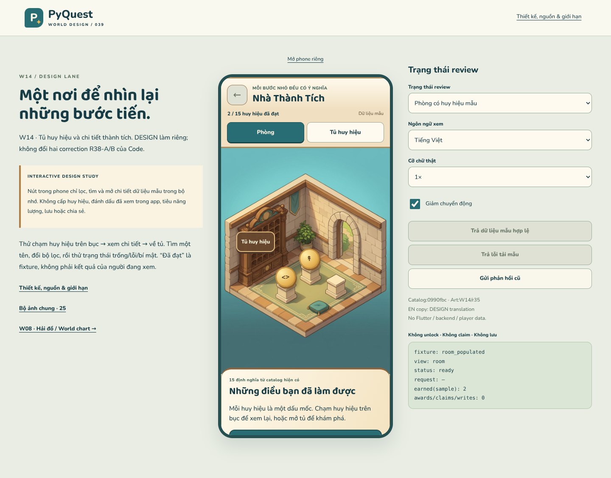

# W14 — Nhà Thành Tích · r39

**Thiết kế độc lập của DESIGN, không phải app đã triển khai.**
Ngày 2026-10-18 · [PQD-005](../coordination/tasks/PQD-005.md) · [Chi tiết/nguồn/giới hạn](SPEC.md)

## Xem và thử

- [Mở bản tương tác](index.html?lang=vi) — chạm huy hiệu trên bục hoặc mở tủ.
- [Phone VI riêng](index.html?phone=1&lang=vi) · [EN / chữ2×](index.html?phone=1&lang=en&scale=2&state=cabinet_all).
- [25ảnh chung r38](../art-review-r38/index.html) và [W08 Hải đồ](../world-travel-r37/index.html) giữ nguyên.
- Preview riêng: `python tools/design/serve_art_review.py --port 8002 --landing w14`.



## Phần thiết kế mới

**Phòng 2,5D → tủ huy hiệu → chi tiết → trở lại tủ**, thay cho chỉ một ảnh taxonomy.
Tủ có bộ lọc, tìm theo tên, trạng thái đã đạt/chưa đạt/bí mật. Chi tiết hiển thị
mô tả và điều kiện từ source, progress mẫu hoặc unknown. Có phòng trống, không
kết quả, tải/lỗi/retry; không nhầm lỗi đọc thành mất thành tích.

- Dùng nguyên nền W14/r35. Medal nổi là lớp UI riêng, không vẽ đè ảnh canonical.
-15định nghĩa nguồn:12thường+3bí mật; không invent rewards. Hai earned mặc định và
  progress4/10 chỉ là mẫu, luôn có nhãn. Không claim/award/lưu/đánh dấu app đã xem.
- Secret chưa đạt không lộ title/condition qua UI/search. Earned-secret có fixture
  riêng. Đây là chính sách hiển thị đề xuất, **không phải bảo mật file JavaScript**.
- VI/EN, cỡ chữ1/1.3/2× thật; title wrap, buttons≥48px, list alternative cho scene,
  keyboard/back/focus. Các nút review nằm ngoài phone.

| Bằng chứng đã chạy | Kết quả |
|---|---:|
| Browser matrix:14states×2phones×2locales×3scales |168/168 |
| Computed-font comparisons |2,688đạt |
| Browser interaction flows |12đạt |
| Source/model invariants |20đạt |
| Page/request errors, external requests |0 |

[Browser report](evidence/browser-checks.json) · [Model report](evidence/model-checks.json) ·
[Static provenance/scope report](evidence/static-checks.json) · [Manifest](manifest.json).

### Một số màn

| Tủ | Chi tiết chưa đạt | Bí mật |
|---|---|---|
| [Xem ảnh](evidence/cabinet_all-390-vi-1x.png) | [Xem ảnh](evidence/locked_detail-390-vi-1x.png) | [Xem ảnh](evidence/secret_locked-390-vi-1x.png) |

[EN2×](evidence/cabinet_all-360-en-2x.png) · [Header EN2×](evidence/earned_detail-360-en-2x.png) ·
[Lỗi tải EN2×](evidence/load_error-360-en-2x.png).

## Ranh giới bàn giao

Chỉ **badge-cabinet slice**, chưa gồm trophy wall/collectible room/creation corner.
Không đổi app, dependencies, CI, backend, engine, economy hoặc room unlocks.
Không sửa các correction R38-A/B của CODE và không giao thêm việc CODE ở lượt này.
PQC-018/PQC-011 giữ trạng thái đang có; receipt HTML không thay review runtime.

Chưa có bộ15icon cuối, layered 3D scene, camera calibration, save/load hoặc kiểm
thử Flutter/thiết bị. Không khuyến khích chơi muộn và không dùng secret làm điều
kiện xây nhà/học. Các giới hạn và khác biệt so với source được ghi trong [SPEC](SPEC.md).

## Tái chạy kiểm tra

```sh
node tools/design/test_house_r39.cjs
# Dùng Playwright + Chromium đã cài ngoài repo, không đổi package/app deps:
NODE_PATH=/home/user/.cache/pyquest-r34-browser/node_modules \
LD_LIBRARY_PATH=/home/user/.cache/pyquest-r34-browser/libs/lib \
node tools/design/check_house_r39.cjs
python tools/design/validate_house_r39.py
```

Browser checker mặc định dùng preview8002; đặt `ART_REVIEW_ORIGIN` nếu đổi port.
Không chạy checker của CODE hoặc ghi đè receipt package CODE.
