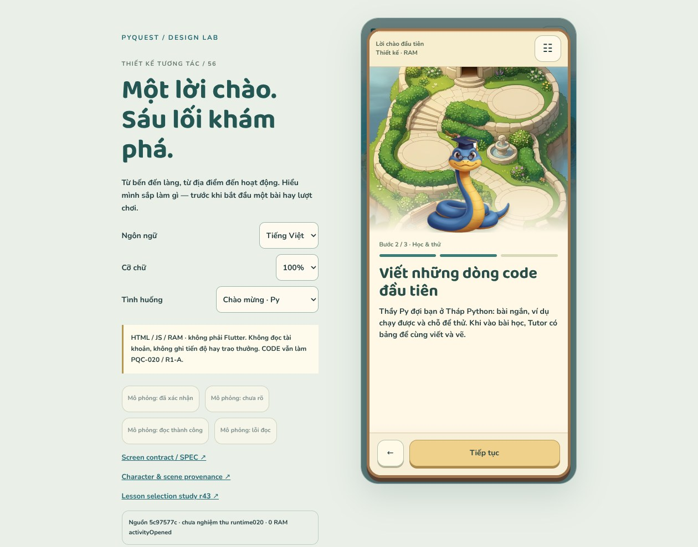

# Một lời chào, sáu lối khám phá — R1-B / r56

**2026-10-18 · DESIGN_STUDY_DELIVERED · runtime NOT_AUTHORIZED.**

Phần DESIGN độc lập theo yêu cầu “thiết kế tiếp”. CODE vẫn sửa PQC-020 / R1-A;
r56 không phải task triển khai mới cho CODE và không sửa Main Map runtime.



## Đã làm

- Ba bước Welcome: Robo chào và giới thiệu lựa chọn; Py giới thiệu học/thử code
  cùng Tutor có bảng; Pip giải thích năng lượng và nghỉ ngơi.
- Sáu bảng địa điểm: canonical name, host, khả năng Python/Creator, tiến độ riêng,
  trạng thái khóa và hành động tiếp theo. Không phải sáu thumbnail thay cho thiết kế app.
- **Mở địa điểm không trừ năng lượng.** Bitsy khóa dẫn tới danh sách Main Quest
  với bài prerequisite được đánh dấu, không tự mở khóa hoặc bắt đầu bài.
- Loading/error khác “chưa chơi”; không dịch chuỗi status tiếng Việt bằng substring.
  Có mẫu giữ nguyên legacy VI và ghi rõ ngôn ngữ nguồn.
- Intro chưa xác nhận lưu có đường đọc lại hoặc khám phá trong phiên; không báo
  “đã lưu” dựa vào RAM. Phần này là proposal, không phải persistence đã triển khai.
- Py và Bitsy có hai mẫu nhân vật 2,5D mới; Robo/Pip và bảy cảnh được tái sử dụng
  từ các study hiện có. [Asset plan](ASSET_PLAN.md) ghi rõ static/alpha/production gaps.
- Chữ thật1/1.3/2×; ở chữ lớn, nội dung lên trước hình thay vì thu nhỏ font/actor.
  Body cuộn riêng, nút hành động luôn nằm trong phone và không che nội dung.

## Xem và thử

[Open study](index.html). Live server:

```sh
python3 tools/design/serve_art_review.py --port 8014 --landing r56
```

Bind0.0.0.0; browser chỉ dùng relative URLs. URL trực tiếp:
`/docs/design/arrival-entrance-r56/index.html?state=bitsy_locked&lang=en&scale=2`.
Có21tình huống. Desktop dùng bàn kiểm; phone dùng nút☷. Đây là công cụ review,
không phải Settings mới của app. Default theo locale trình duyệt VI/EN, override
chỉ trong tab, không ghi account hoặc preference.

**Luồng thử:** đọc ba bước → finalContinue → trạng thái ghi nhận → chọn khám phá
trong phiên hoặc mô phỏng xác nhận → chọn địa điểm → xem/đóng hoặc vào route preview
→ về đúng nút và vị trí cuộn. Nút “mô phỏng” chỉ cung cấp callback RAM; không fake
network success bằng timer.

- Tab/Shift+Tab đi qua nút và vùng nội dung cuộn. Escape đóng sheet/route preview.
- Escape trong Welcome lùi bước khi có thể, không đánh dấu đã xem.
- Công cụ “đã xác nhận” trong intro-loading mô phỏng đã xem; “đọc thành công” mô
  phỏng chưa xem. Trong sheet-loading, “đọc thành công” trả lại status fixture.
- Đường lesson dừng ở preview và giữ `openLessonId` từ catalog. Không chạy lesson,
  không thay thế [study chọn bài r43](../chapter-journey-r43/README.md).

## Bằng chứng

| Kiểm tra | Kết quả | Giới hạn |
|---|---:|---|
| JS model |36checks +18zero-charge combinations | Không Dart/SQLite/event authority |
| Browser |252configs |21fixtures×2viewport×2locale×3scale |
| Targets |768checks | Product controls, không workbench |
| Font |468assertions | Computed font thật, không zoom ảnh |
| Interaction |278flows | Sáu địa điểm, focus/scroll, retry, read-back, callbacks cũ |
| Captures |22 | HTML Chromium153, không Flutter/APK |
| Integrity |21source pins,11art files,12references | Catalog/link/scope checks, không runtime acceptance |

[Model](evidence/model-checks.json) · [Browser](evidence/browser-checks.json) ·
[Static](evidence/static-checks.json).

Đã mở xem ảnh gốc Py/Bitsy, Welcome r40, screenshot cũ để nhận diện; desktop,
Maze390VI1×, Welcome360EN2×, Bitsy360EN2× và intro-unknown390VI1×. Đã mở thêm
ảnh prerequisite/legacy-data/zero-energy để kiểm tra phần cuộn. Không nói đã nhìn
thủ công toàn bộ252configs. Không chứng nhận screen reader/WCAG hoặc đo thiết bị.

### Chạy kiểm tra lại

Cần Node, Pillow và Playwright/Chromium. Không cần Flutter SDK cho study.

```sh
node tools/design/test_arrival_r56.mjs
LD_LIBRARY_PATH=/tmp/al2023/lib NODE_PATH=/home/user/.cache/pyquest-browser/node_modules \
  node tools/design/check_arrival_r56.cjs
/home/user/.cache/design-venv/bin/python tools/design/validate_arrival_r56.py
```

Có thể đặt `ART_REVIEW_ORIGIN`. Cache và Chromium binaries không commit vào Git;
nếu môi trường khác, chuẩn bị riêng các dependency trên. Builder tùy chọn
`tools/design/build_arrival_r56.py` tạo exports/catalog từ ảnh và source đã pin,
không tái sinh ảnh AI.

## Nguồn và phối hợp

[SPEC](SPEC.md) · [Source notes](SOURCE_NOTES.md) · [Catalog](catalog.json) ·
[Source manifest](source-manifest.json) · [PQD-017](../coordination/tasks/PQD-017.md).

Pin source5c97577c, **không phải SHA đã nghiệm thu020**. Cuối lượt quan sát CODE
831f7cb4: chỉ đổi tests/focused workflow so với pin; cả21file liên quan vẫn cùng
hash. [Observation](partner-observation.json) ghi focused/normal failure và
maintenance còn chạy tại lúc quan sát; không tự kết luận kết quả sau đó.
Không merge CODE, dispatch CI hoặc sửa work order020 trong r56.

R1-B Welcome/sheet là study, lựa chọn bài dùng r43; toàn bộ R1 và redesign toàn app
chưa hoàn tất. Bước DESIGN độc lập sau: Bug Hunter gameplay/results. Nếu CODE gửi
bàn giao hoặc xin phạm vi sửa020, Lead review riêng trước; không giao thêm runtime
Bug Hunter/R1-B từ các tài liệu thiết kế này.
