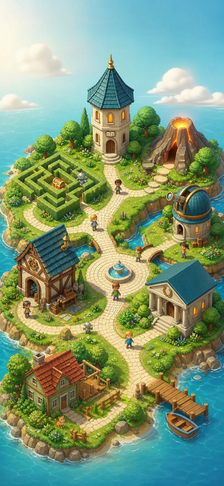
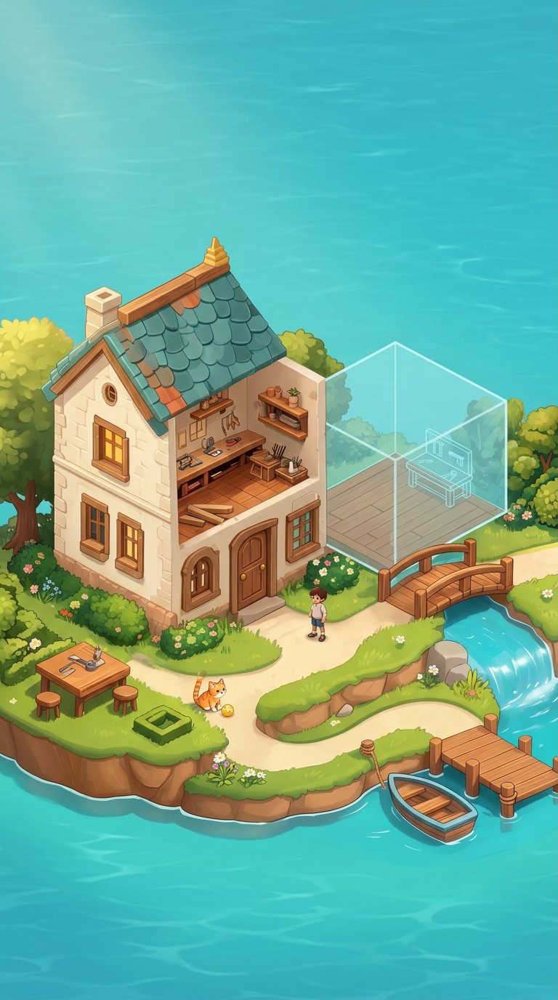
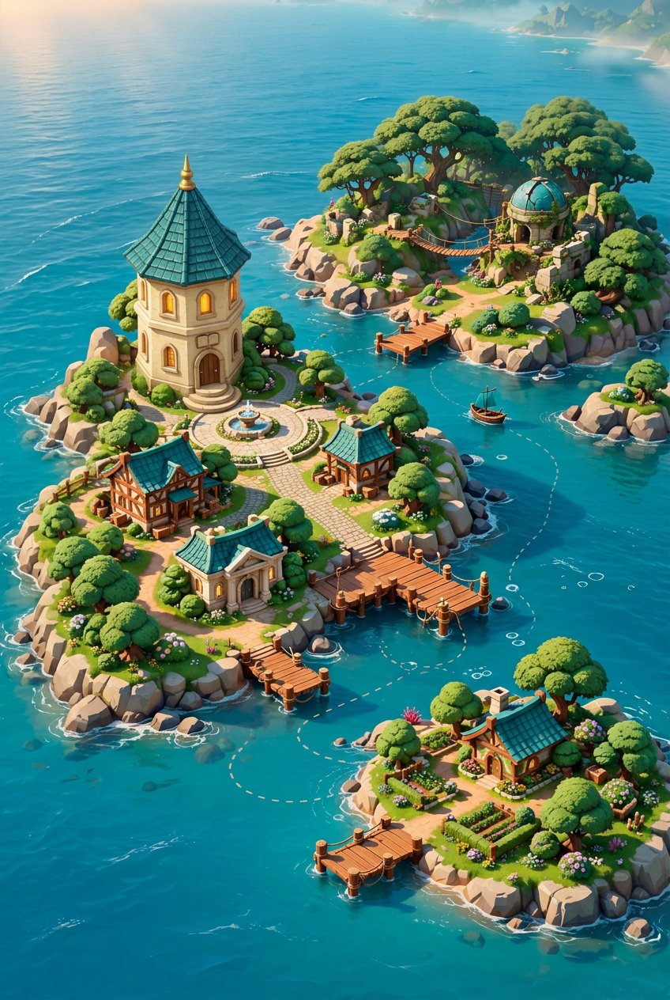

# PyQuest — Bộ concept 2,5D mới / r33

2026-10-18 · **Ba ảnh concept đã tạo và được chọn; chưa phải UI/asset production.**
Chuẩn: [ART_DIRECTION_2_5D](../ART_DIRECTION_2_5D.md). Luồng/chức năng:
[WORLD_EXPANSION_REDESIGN](../WORLD_EXPANSION_REDESIGN.md).

## 1. Làng công cộng — W01

**Neo vật liệu và landmark của cả bộ.** Một scene liên tục có học viện, Maze, núi
lửa, đài thiên văn, xưởng, nhà thành tích; lối về khu nhà và bến là hai hướng khác.
Đá sáng, mái teal, gỗ ấm, bóng tiếp xúc và actor có khối. Không thay thành sáu card.

Đây chưa phải geometry điều hướng; nhân vật/bóng/đồ đang bake trong ảnh. Không thể
lấy ảnh này rồi nói đã có sprite walk cycle hay đúng hitbox. Khi compose màn cần
điều chỉnh camera/crop/safe area, không thu bé mọi điểm đến để vừa một màn.

## 2. Nhà, nội thất và preview mở rộng — W02/W03/W07

Có sân, lối đi, workbench trong phòng cắt mái, đồ chơi của mèo và bến. Phần xanh
trong suốt chỉ là **xem trước**, chưa xây và chưa tiêu vật liệu; không phải quyền
mua hoặc ledger thật. Đã sửa từ ảnh được chọn: giảm ghost room quá lớn, bỏ ghost
mascot, thêm chiều sâu/vật liệu và môi trường nước theo làng.

**Còn phải xử lý trước production:** chốt mặt sàn/đỡ/cửa nối cho preview; calibration
footprint và lối đi; mức chi tiết nhân vật/nội thất cần tiếp tục đối chiếu W01.
Không lấy cạnh phòng trong ảnh làm collision hoặc dùng camera giả định như số đo.

## 3. Hải đồ — W08

Biển liên tục nối đảo công cộng, đảo nhà riêng và khu rừng khám phá. Đã chỉnh tháp
để nhận ra cùng họ landmark với W01. Có bến/đường thuyền thay vì lưới thumbnail,
không padlock/giá phủ lên tất cả đảo. Chưa có travel system hoặc nội dung đảo mới.

Atlas giản lược công trình, không phải bản chụp địa lý chính xác của map đang chạy.
Đường đi và khả năng vào vùng phải do domain authority quyết định, không suy từ ảnh.

## 4. Những gì đã làm và chưa làm

| Mức | Trạng thái r33 |
|---|---|
| Bốn tài liệu có chuẩn2,5D xuyên suốt | Đã bổ sung, cùng trỏ một art contract |
| Ba concept riêng DESIGN | Đã tạo, user chọn từng ảnh; home/atlas được chỉnh coherence sau chọn |
| Kiểm ảnh | Đã xem native image, đối chiếu vật liệu/landmark/chức năng; nhận ở mức reference, không full production approval |
| Screen composition360×640/390×844, VI/EN, scale/keyboard/states | **Chưa hoàn tất**; native aspect ratios không phải proof phone layout |
| Runtime layers/alpha/pivot/nav/occlusion/animation | **Chưa có**; tất cả ba ảnh là opaque JPEG |
| Các màn Tutor/Thành Tích/Arena | Giao CODE/PQC-017 design-only, chưa nhận kết quả |
| Visit/pet/shop/Creator/arcade/result/shared panels đầy đủ | Còn trong đợt tiếp, không coi ba cảnh này thay thế toàn app |
| APK/UI Flutter mới | **Không thay đổi trong gói này** |

Việc chọn ảnh không tự duyệt mọi trạng thái hoặc gate runtime. Có thể giữ ảnh làm
reference ngay cả khi production pack cần redraw/calibration sâu hơn.

## 5. Phân công và nguồn sự thật

- DESIGN sở hữu chuẩn chung, ba concept trong `concepts/`, review/coherence và gói
  R1 sau art gate. **W01 là neo vật liệu chính**; W02/W08 còn là nghiên cứu chức năng/
  tỷ lệ, không dùng chỗ còn lệch để hợp thức hóa ba phong cách khác nhau.
- CODE làm ba màn theo [PQC-017](../../implementation/coordination/tasks/PQC-017.md),
  chỉ ghi `code/**` và work order017. Được làm artwork/layout/state, không sửa app.
- 011 tại `a331ac1` đã bàn giao unverified; công việc art không khiến011 accepted.
- [manifest.json](manifest.json) ghi dimensions, hashes, provenance, reference hashes,
  prompt briefs và các sửa sau lựa chọn. Không tuyên bố CC0, model3D, quyền độc quyền
  hoặc license stock. Ảnh AI theo điều khoản công cụ và review quyền trước release.

Nguồn prompt là art contract và mô tả chức năng W01/W02/W03/W08, tham chiếu hai ảnh
AI cũ trong dự án; không nhập nhân vật có thương hiệu từ21 ảnh inspiration.
