# PyQuest r34 — Không gian để chơi, học và sáng tạo

**2026-10-18 · DESIGN · 10 concept mới + bản xem bố cục điện thoại.**
Không phải ảnh APK, không phải bộ asset production. R1 runtime chưa được mở.

## Mở bộ thiết kế

**[Gallery tương tác](index.html)** — chọn một trong10 màn, VI/EN,
390×844 hoặc360×640, chữ100%/130%/200% và các trạng thái riêng của từng màn.
Có42 trạng thái mẫu; các nút chỉ đổi mẫu, không mua/gửi quà/lưu nhà hay chạy game.

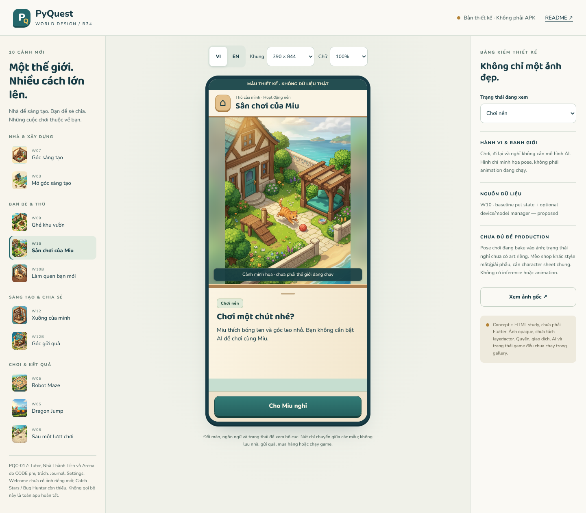

Chạy local từ repo root:

```sh
python tools/design/serve_art_review.py --port 8000
```

Mở server ở cổng8000; `/` chuyển thẳng tới gallery. Server chỉ đọc `docs/design/`
và font có sẵn, không phục vụ Git metadata/app source. Bind0.0.0.0 hỗ trợ live preview.
Gallery dùng file và font local, không gọi backend, CDN, AI hoặc analytics.

## 1. Kết quả review code trước khi làm hình

**PQC-011 CHANGES_REQUESTED tại `a331ac110f19de63e9be6884d08db8c436054f50`.**

1. CI thật đã fail analyze: thiếu `ExecutionResult`, thiếu `FlutterError`, truyền
   `Duration` vào vị trí `EnginePhase` của `pumpAndSettle`, cùng import diagnostics.
2. Loader so sánh hai Set mới bằng `!=`: catalog hợp lệ cũng bị reject ở cả hai chỗ.
3. Test đòi beat3 dù replay→next→previous đưa vềbeat0; edit/run không được tự nhảy beat.
4. Listener editor tính cả selection-only là learner action, có thể bỏ wait khi chỉ
   đặt con trỏ. Cần phân biệt thay text với thay selection/composing.

[Review đầy đủ và yêu cầu sửa](../coordination/reviews/PQD-003-r34.md) ·
[CI output exact SHA](../coordination/reviews/PQC-011-r3/ci-check.json).
Run39055410280/check117462432865: analyze1,8issues; Settings/ordinary/render skipped.
Không dùng generation success để tự nghiệm thu011. Không sửa runtime trong gói này.
CODE giữ017 artwork riêng và sửa011 trong đúng allowlist cũ, không CI/deps/APK.

## 2. Bộ hình mới — từng cảnh riêng, không ghép thumbnail

Dùng [W01 r33](../art-refresh-r33/concepts/w01-village.jpg) làm neo vật liệu/ánh sáng.
Mỗi hình là một ảnh AI-generated độc lập, cùng brief2,5D; **chưa được user chọn hoặc
production-approved**. Đã xem từng ảnh ở kích thước lớn. Những sai khác silhouette,
vật liệu/nhân vật và geometry được giữ trong manifest/review, không che bằng nhãn pass.

### W07 · Nội thất và sắp xếp

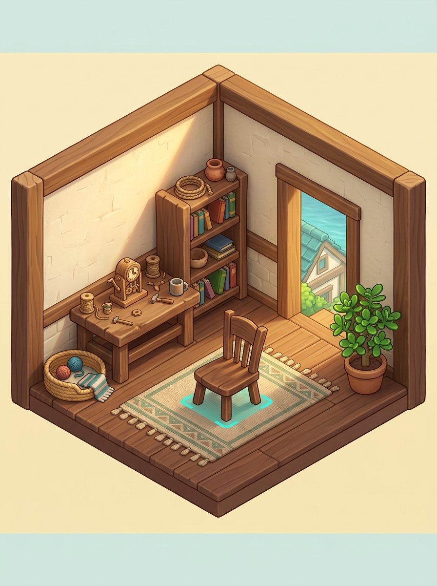

Từ ngoài nhà vào phòng có công dụng: bàn làm việc, ghế chọn được, khu pet và đường ra.
State studies: bản nháp, chắn cửa, rời chưa lưu, lưu thành công. **Cần sửa** nối sàn/
ngưỡng cửa: cửa hiện nhìn xuống mái khác. Ghế và cyan footprint còn bake vào ảnh,
không phải layer hoặc kết quả kiểm collision.

### W03 · Dự án mở rộng

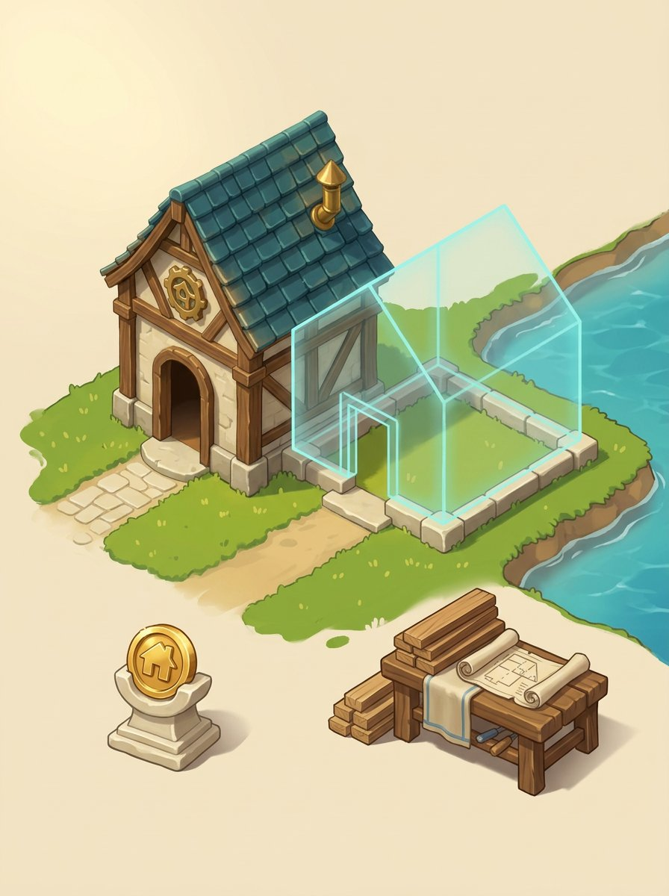

Điều kiện giữ lại và chi phí dùng khi xây tách rõ.5states: thiếu, nguồn, xác nhận,
chưa rõ kết quả, đã xây.3gỗ/2vải là fixtureP06C, không phải recipe đã phát hành.
**Cần sửa** sàn trong phòng preview còn là cỏ và nối cửa chưa rõ; chưa có art phòng
đã xây. State built trong gallery ghi cảnh vẫn là preview, không giả nhà đã thay đổi.

### W09 · Ghé nhà — chủ vắng và quyền khách

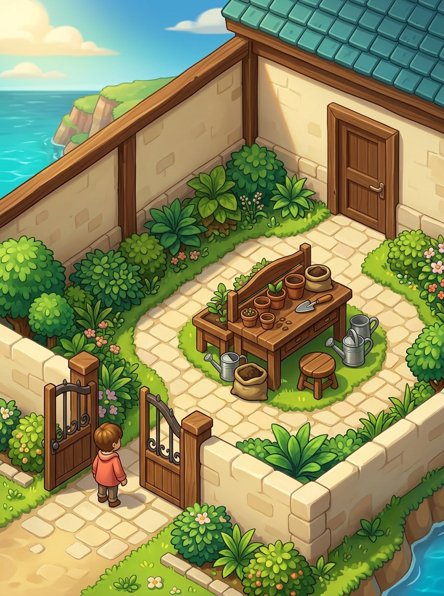

Một khách ở sân, không vẽ chủ giả online.4states: chủ vắng/snapshot, quyền khách,
thu hồi quyền, mất kết nối. **Ở revoked/offline, gallery bỏ ảnh khỏi scene**, không
chỉ thêm banner lên ảnh nhà cũ. Đây là hành vi mockup, không phải security proof:
app thật phải kiểm quyền và không gửi dữ liệu phòng riêng xuống client khách.

### W10 · Pet có khu chơi và nghỉ

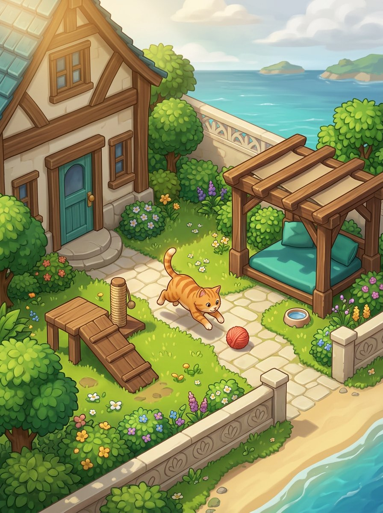

4states: chơi nền, nghỉ, AI chưa hỗ trợ, ký ức/riêng tư. Baseline không phụ thuộc LLM;
không cloud fallback âm thầm, không phạt pet khi trẻ nghỉ. Pose nghỉ riêng chưa có;
gallery ghi rõ ảnh vẫn là pose chơi, không giả animation hoặc inference.

### W10b · Làm quen/mua thú

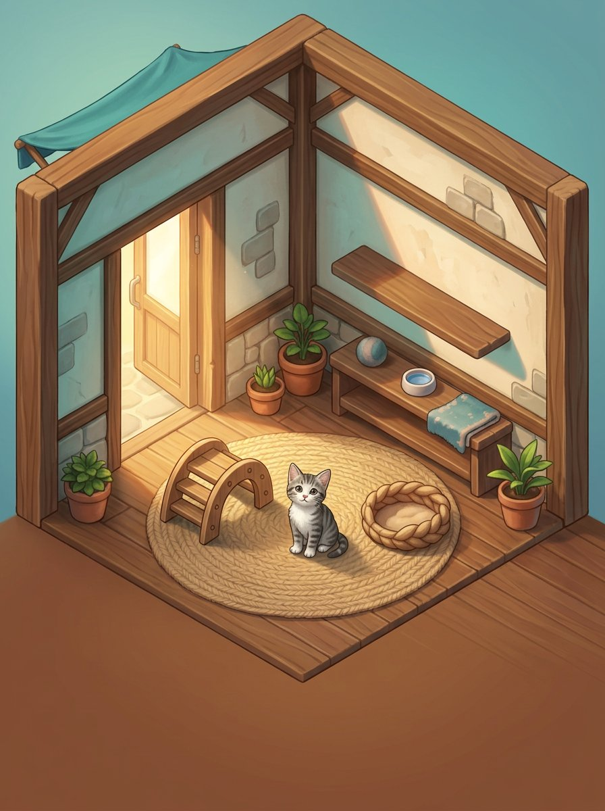

4states: capability, phụ huynh, chờ xác minh, restore/lỗi. Không bake giá, không nút
mua khi dữ liệu chưa có, không nói parental gate/receipt đã chạy. Mèo xám đang khác
style mắt/giải phẫu với mèo sân; cần character sheet chung trước production.

### W12 · Creator — làm, thử, lưu, chia sẻ

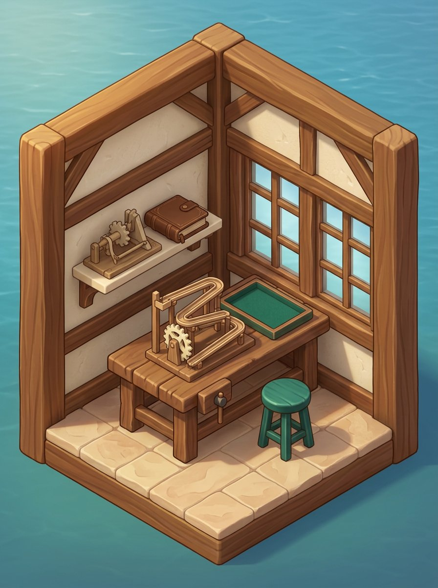

5states: draft, test, private saved, moderation pending, save error. Không đổi luật
game/đáp án theo cơ cấu trong ảnh; cơ cấu chưa được test vật lý. Cần màn editor/code/
timeline riêng, không coi một workbench hoàn tất toàn Creator.

### W12b · Chuẩn bị quà

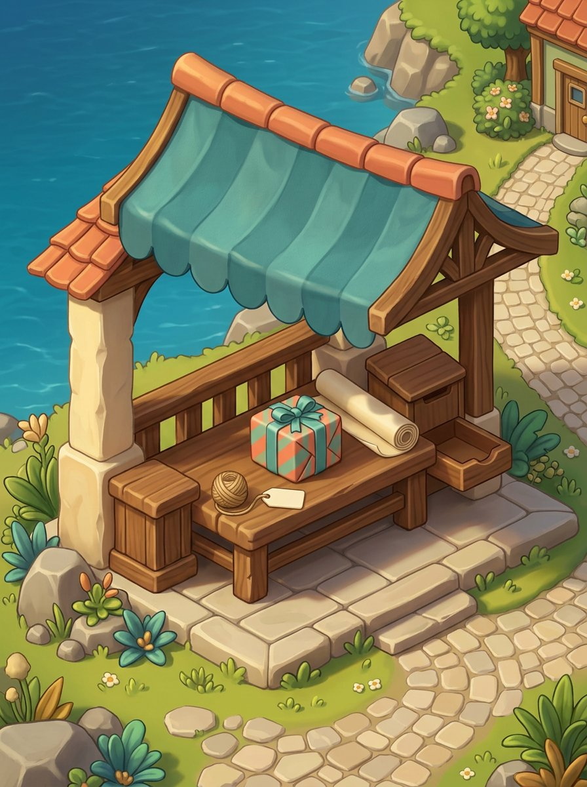

4states: chuẩn bị, xác nhận, chờ nhận, từ chối. Không auto-send, không cấp skill badge,
không áp lực người nhận. Friend list, chọn người, invite, report/block vẫn thiếu;
ảnh bưu đình không được gọi là trải nghiệm bạn bè đã hoàn chỉnh.

### W05 · Robot Maze

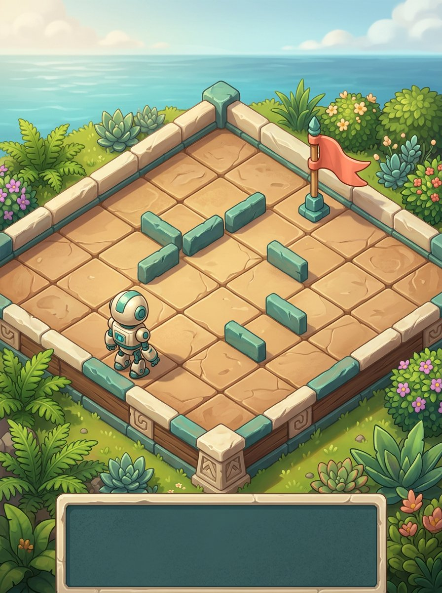

4states: chuẩn bị, pause, retry, kết thúc. Lưới AI không khớp level data và có bảng
trống bake dưới ảnh. **Không dùng làm playable board hoặc collision map.** Khi port,
tile/obstacle/actor phải từ source engine; không đổi puzzle để vừa ảnh. Robot cũng
chưa thống nhất silhouette với robot màn kết quả.

### W05 · Dragon Jump

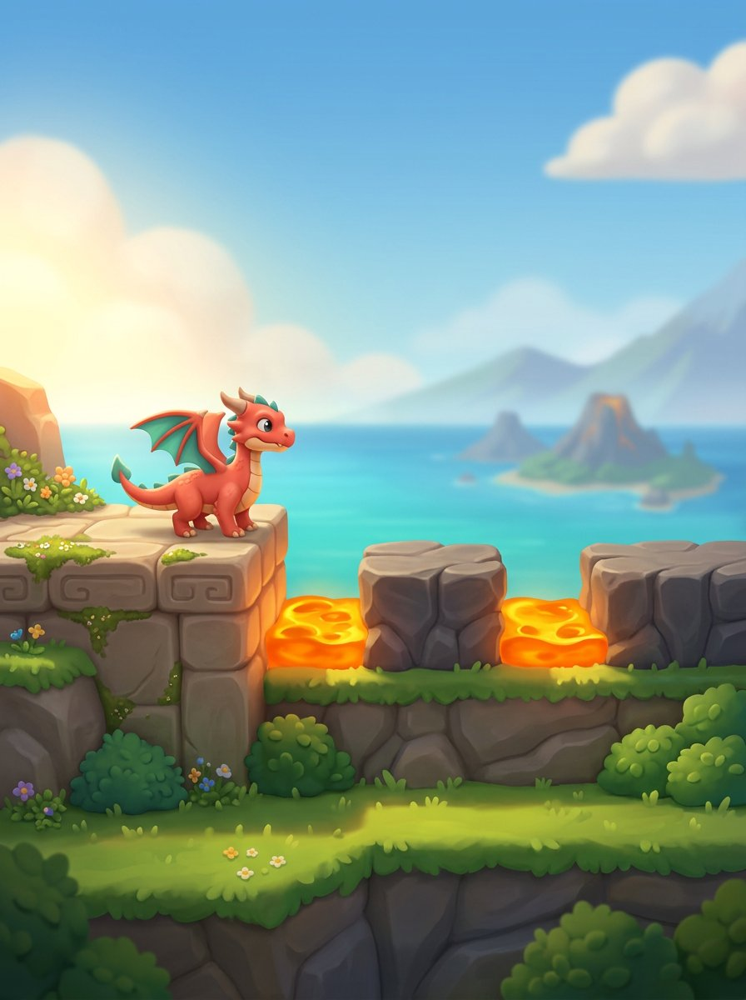

Giữ side-view phục vụ luật nhảy nhưng vật thể vẫn có khối, bóng và các lớp cảnh.
4states: chuẩn bị, pause, retry, result. Khoảng cách/bục/animation phải do game engine
quyết định; không đo pixel ảnh để đổi đáp án. Render rồng mềm hơn linework của các
cảnh nội thất, cần chỉnh material/character trước production.

### W06 · Sau lượt chơi

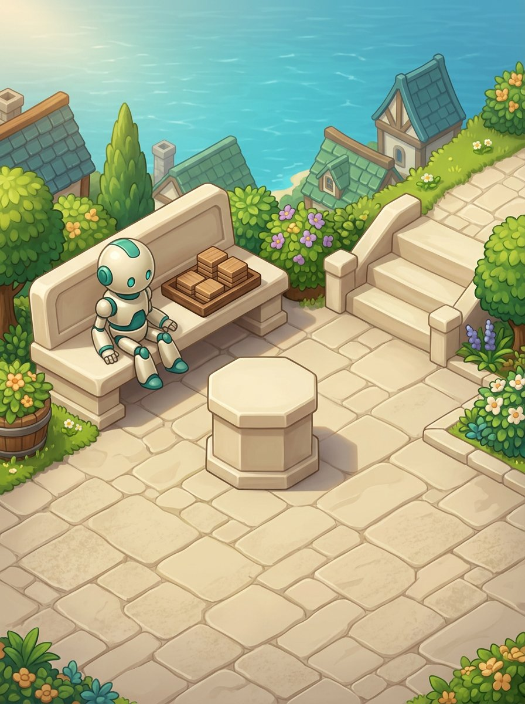

4states: recorded, pending, retry, error. Bục trống tránh ép mọi kết quả thành thắng.
Đã ghi nhận tự động thì không claim lần hai; lượt thất bại không xóa grant chờ của
lượt trước. Đây là thiết kế đọc outcome/receipt, không có hệ thống thưởng mới.

## 3. Phone/state studies — chữ và điều khiển ngoài ảnh

Các file `scenes.js`, `screen-copy.js`, `gallery.js`, `gallery.css` tạo bố cục có
khung/vật liệu cùng họ; không paint code/giá/chữ vào JPEG. Copy ngắn hướng người dùng
ở trong phone; ghi chú authority/production nằm ngoài ở rail review.

- Một vertical scroll owner cho scene + nội dung; CTA chính ở footer riêng.
- VI/EN đầy đủ cho text trongphone, tên màn và state; không đổi ID/fixture theo locale.
- Scale2 không cap1.2. Trên360×640 chữ lớn cần cuộn, không ép toàn nội dung vào một ảnh.
- Nút chính tối thiểu48px; chuyển mẫu state thật bằng click, không chỉ radio giả.
- Không hỗ trợ keyboard nhập code hay drag nội thất; đây không phải những khả năng đã test.
- Cảnh khác state có thể vẫn dùng concept gốc; riêng privacy hide đã xử lý. Không có
  visual art riêng cho mọi loading/fail/saved/pet pose.

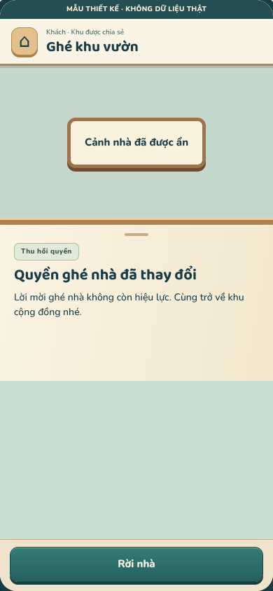

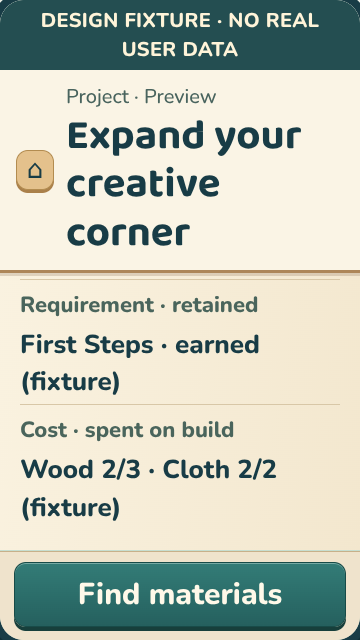

## 4. Checks đã chạy

[Receipt browser](evidence/checks.json), Chromium153.0.8010.0:

- **504/504** trường hợp:42state ×2locale ×2viewport ×3textscale.
- **42/42** primary-action transitions; locale giữ state đang chọn.
- Không overflow ngang trong phone; cuối nội dung cuộn tới được; CTA đủ48px và
  hit-test được; cỡ chữ thực tăng tới2; privacy scenes không còn `img` khi bị thu quyền.
- Host gallery smoke ở360px; không pageerror/HTTPerror trong lần chạy cuối.
- **16 screenshots** gồm10scene VI390×844,4state ngoại lệ,1EN360×640 scale2,
  1overview. Các phonePNG đúng pixel dimensions; hash trong manifest.
- Decode/hash10JPEG +16PNG, referenceW01 hash và local-link checks chạy riêng.

**Không suy rộng:** chưa Flutter/analyze/test trên DESIGN, không device/OS keyboard,
screenreader audit hoặc usability test với trẻ; contrast chưa audit toàn bộ. Không
housing/gameplay/inference/multiplayer/commerce proof. Receipt chỉ cho HTML study.

Tái chạy browser checks ngoài dependency app:

```sh
# Cài vào scratch, KHÔNG thay app dependencies hoặc CI:
npm install --prefix /home/user/.cache/pyquest-r34-browser --no-audit --no-fund \
  playwright-core@1.64.1 @sparticuz/chromium@153.0.0
# Bật server ở terminal/process riêng rồi chạy:
NODE_PATH=/home/user/.cache/pyquest-r34-browser/node_modules \
  node tools/design/check_art_r34.cjs
```

Sandbox tối giản thiếu NSS/NSPR: đã giải nén `al2023.tar.br` có sẵn trong package
Chromium vào scratch và đặt `LD_LIBRARY_PATH` tới thư mục `lib` khi chạy; không
cài/thay OS hoặc Flutter SDK. Recipe cụ thể nằm trong [browser setup](BROWSER_CHECKS.md).

## 5. Coverage thực tế, phần còn lại

| Nhóm | Hiện có | Chưa xong |
|---|---|---|
| W01/W02/W08 |3concept r33 đã publish | Layer/nav/state, camera/geometry production |
| W03/W07/W09/W10/W10b/W12/W12b/W05Maze/W05Dragon/W06 |10concept và42state HTML r34 | Art corrections, full state/input/sprite/runtime integration |
| W13 Tutor/W14 Nhà Thành Tích/W11 Arena |Giao CODE qua017 |Chưa nhận/review artwork của CODE trong gói này |
| W04 Journal, Settings, Welcome |Brief đã viết |3lệnh tạo ảnh bị giới hạn10ảnh/lượt; **không có ảnh mới** |
| Catch Stars/Bug Hunter |Module ở activityRegistry |Chưa có refresh scene trongr34, không giả Maze/Dragon đại diện đủ |
| Social/Creator sâu |Các flow/chốt quyền trong contract |Friend list/invite/report/block, code editor/timeline, moderation đầy đủ |
| Các lỗi/sự kiện biên |Một số state minh họa |Reconnect, refund/revoke entitlement, concurrent layout, mọiloading/error chưa đủ |

Không gọi13concept DESIGN (r33+r34) hoặc thêm3concept CODE là xong toàn app.
Cần vòng correction/style/character sheets và production layers riêng, rồi mới
mở R1 với allowlist/navigation/evidence runtime. Voice không được trở thành blocker
vô hạn cho UI, nhưng ảnh opaque cũng không được tự nhận đủ để port.

## 6. Provenance và workspace

[Manifest](manifest.json): dimensions/bytes/hash, source W01, prompt briefs, review
notes, state IDs và readinessfalse. AI-generated; không claim CC0/exclusivity/license
bên thứ ba. Không dùng nhân vật có thương hiệu trong brief. Kiểm điều khoản công cụ/
chính sách phát hành trước release. Font dùng bản/OFL có sẵn trong `app/assets/fonts`.

Đầu lượt có hai file r33w02/w08 khác HEAD, hash khớp selected-original trước correction.
Giữ nguyên thay đổi đó, **không stage hoặc sửa manifest/receipt lịch sử r33**. Gói r34
chỉ tham chiếu W01 không đổi; tránh vô tình đưa ảnh lệch manifest vào commit này.
