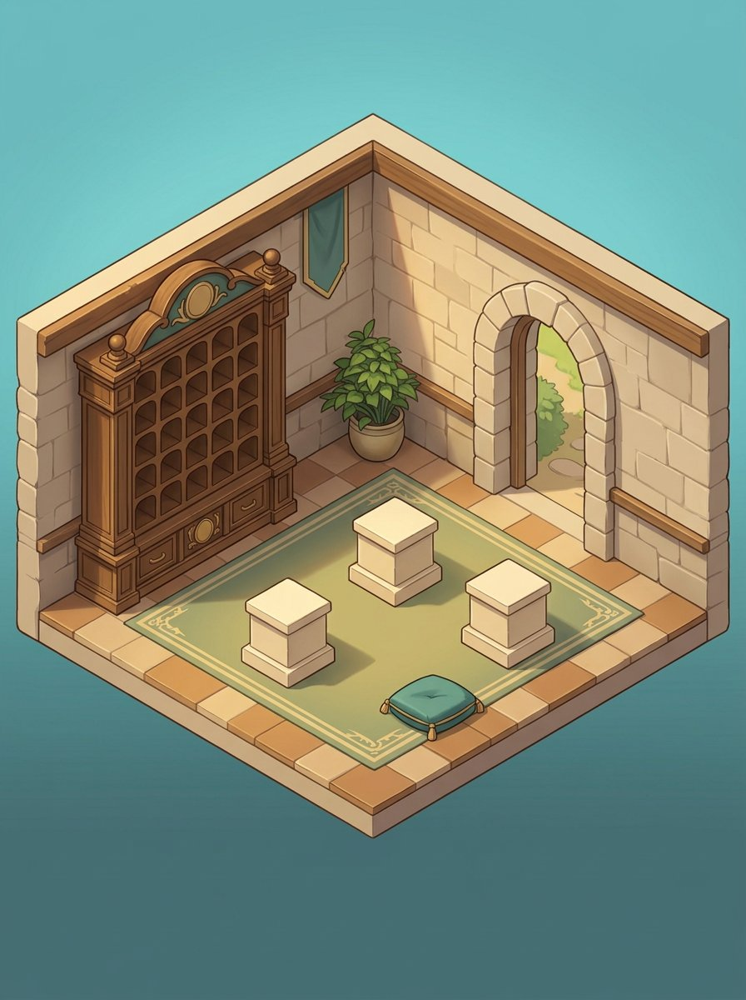
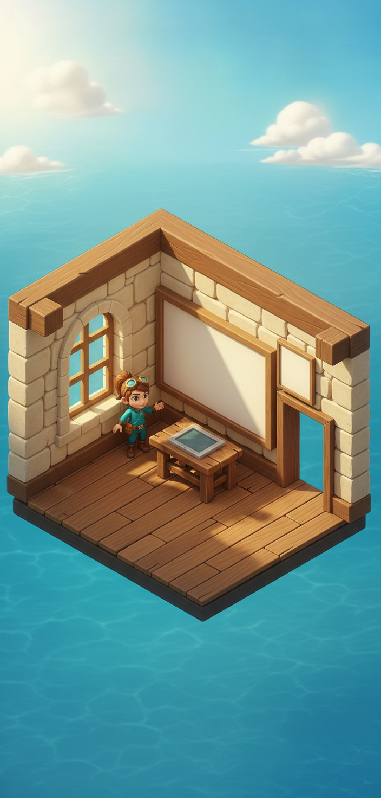
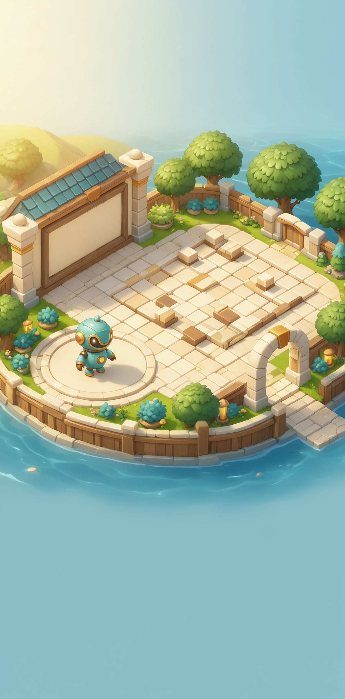
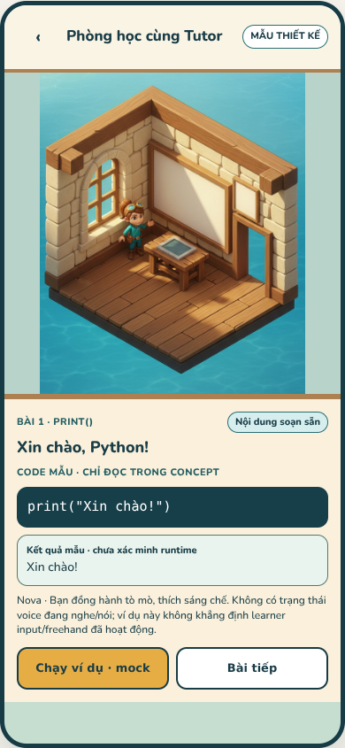

# PyQuest r35 — Bộ ảnh chung DESIGN + CODE

**2026-10-18 · 16 cảnh active · đã review gói CODE `e3ec5f1`.**
[**Mở gallery chung**](index.html) · [Catalog/hash/nguồn](catalog.json) ·
[Quyết định đồng bộ](STYLE_SYNC.md) · [Review đầy đủ](../coordination/reviews/PQD-003-r35.md)

Gallery có từng ảnh đủ kích thước, nguồn DESIGN/CODE, ghi chú cần sửa và đường sang
bố cục/trạng thái. **Không còn phải tự tìm hai bộ ở hai nhánh.** Đồng bộ ở đây là
chung nguồn ảnh + chuẩn + corrections/layout, không phải toàn bộ art đã production-ready.

## Đã review và sửa những gì?

| Màn CODE | Nhận xét | Bản dùng chung |
|---|---|---|
| W13 Tutor |Nova/stone/wood phù hợp hướng; header chữ2 tràn và lộ debugstepID |Giữ concept. Sửa bố cục, dùng font chung, bỏID kỹ thuật; code/output vẫn là sample |
| W14 Nhà Thành Tích |Góc frontal/candle lệchW01; cúp bake không dùng choempty; taxonomy không phảiempty thật |Correction3/4 daylight, tủ/bục trống; thêmempty riêng; giữ nguyên bảnCodegốc |
| W11 Arena |Practice scene cókhối, Robo đúnghướng; chữ2 tràn |Giữ concept, sửa layout. Không có Arena/rules/online runtime được chứng minh |

### W14 — bản chỉnh đang dùng



[Bản CODE trước correction](../art-refresh-r33/code/w14-achievements/concept.png)
được giữ nguyên, không ghiđè hoặc giả hash trước restyle mà CODE chưa lưu.
[Prompt chỉnh](corrections/w14-prompt.txt) +inputhashes trongcatalog.

### W13 và W11 — giữ concept, không vẽ lại nhân vật tùy ý





Các ảnh vẫnopaque, character/shadow bake, khôngnavigation/physics. W14camera là
illustrative3/4, chưa đo chuẩnorthographic. Đọc [STYLE_SYNC](STYLE_SYNC.md) để không
sao chép các lỗi geometry hoặc trộn characterfamily đã ghi của các ảnh cũ.

## Đủ16 ảnh để CODE xem trước khi làm tiếp

| ID | Ảnh active | Bố cục/state |
|---|---|---|
| W01 |[Làng](../art-refresh-r33/concepts/w01-village.jpg) — **neo chính** |Concept |
| W02 |[Nhà/sân correctedpublished](published-r33/w02-home-expansion.jpg) |Concept |
| W08 |[Hải đồ correctedpublished](published-r33/w08-archipelago.jpg) |Concept |
| W07 |[Nội thất](../art-refresh-r34/concepts/w07-interior.jpg) |[Study](../art-refresh-r34/index.html#w07-interior) |
| W03 |[Dự án](../art-refresh-r34/concepts/w03-project.jpg) |[Study](../art-refresh-r34/index.html#w03-project) |
| W09 |[Ghé nhà](../art-refresh-r34/concepts/w09-visit.jpg) |[Study](../art-refresh-r34/index.html#w09-visit) |
| W10 |[Miu chơi](../art-refresh-r34/concepts/w10-pet.jpg) |[Study](../art-refresh-r34/index.html#w10-pet) |
| W10b |[Petshop](../art-refresh-r34/concepts/w10b-pet-shop.jpg) |[Study](../art-refresh-r34/index.html#w10b-pet-shop) |
| W12 |[Creator](../art-refresh-r34/concepts/w12-creator.jpg) |[Study](../art-refresh-r34/index.html#w12-creator) |
| W12b |[Góc quà](../art-refresh-r34/concepts/w12b-friends-gifts.jpg) |[Study](../art-refresh-r34/index.html#w12b-friends-gifts) |
| W05Maze |[Maze](../art-refresh-r34/concepts/w05-maze.jpg) |[Study](../art-refresh-r34/index.html#w05-maze) |
| W05Dragon |[Dragon](../art-refresh-r34/concepts/w05-dragon.jpg) |[Study](../art-refresh-r34/index.html#w05-dragon) |
| W06 |[Result](../art-refresh-r34/concepts/w06-result.jpg) |[Study](../art-refresh-r34/index.html#w06-result) |
| W13 |[Tutor CODE](../art-refresh-r33/code/w13-tutor/concept.png) |[**Synced**](layouts/w13-tutor.html) |
| W14 |[Achievements correction](corrections/w14-achievements.jpg) |[**Synced**](layouts/w14-achievements.html) |
| W11 |[Arena CODE](../art-refresh-r33/code/w11-arena/concept.png) |[**Synced**](layouts/w11-arena.html) |

CODE phải mở từngảnh đủ kích thước, đọcnotes và xemlayouts; không chỉthumbnail hay
manifest. Ghi16observations/hashes thật vào `reviewed-inputs.json` cùngcommitart018,
không ACK-only. Không dựng checkbox giả làm bằng chứng đãxem.

## Giao CODE9 ảnh còn thiếu — PQC-018

**[Work order đầy đủ](../../implementation/coordination/tasks/PQC-018.md)**, art-only.

- **Đợt A5, bàn giao trước:** Sổ hành trình, Settings, màn chào, Catch Stars, Bug Hunter.
- **Đợt B4:** bạn bè/lời mời, Creator editor, phòng xây xong, Miu nghỉ.

Giữ artwork017 đã làm, không bắt vẽ lại cả3. Newart chỉ vào
`docs/design/art-completion-r36/code/**` +task018. Không ghiđè masterr33/r34/r35,
không app/tests/deps/CI/backend/economy. Mỗiđợt commit riêng `[skip ci]`, provenance,
copyVIEN/state/phone vàchecks thật. Nếu tool thiếu/limit thì báo đúngblocker.

Đây là9lỗ hổng ưu tiên, không có nghĩa9ảnh sẽ hoàn tất mọi state/animation/editor/
interaction. Layer, rig, geometry/actor calibration và nhiều trạng thái còn ởbacklog.

## Bằng chứng browser — không gọi staticcheck là renderpass

- [Original CODE](evidence/original-layouts.json): **56cases**, **28overflow ngang**
  ở2×, debugstepID visible16cases. Đây là finding mới từ browser, không suy từ source.
- [Synced DESIGN](evidence/synced-layouts.json): **64cases**, **0overflow ngang**,
  debugstepID0; sốcases tăng vìW14thêmempty thật. VI/EN,390×844/360×640,1×/2×.
- Nút trong3phoneCODEderived vẫndisabledmock. Khôngthực thi code, khôngchạyAI/game,
  khôngnavigation tớiFlutter. Sharedfont/vậtliệu vàtextwrap đã sửa; cần cuộn ởscale2.
- [Static/source checks](evidence/static-checks.json): exact20fileimport,16activeimages,
  sourcepin/blob/hash, derivedcrops vàlocalpaths.
- [Gallery smoke](evidence/atlas-checks.json):16ảnh decode,13layouttargets,
  điều hướng/click/iframe vàmobilehost smoke. Không thay1441/390CSSpx thànhdeviceproof.



**Chưa kiểm:** Flutter, device safe-area/keyboard, screenreader, toàn bộcontrast,
child usability, realsharedpresence, rewardtransaction, inference, physics/collision.
W13sampleoutput khôngphải runtime executionreceipt. expected_outputnull chỉ cónghĩa
khôngfieldoracle sẵn;011 vẫnphải chạytrustedcode quaengine côlập đểvalidate.

## Chạy/xác minh lại

```sh
python tools/design/serve_art_review.py --port 8000
# / mở atlasr35. Server read-only cho docs/design, task docs và app/assets/fonts.
# Không phục vụ .git hoặc app/lib.

# Browser dependencies ở scratch, recipe tại art-refresh-r34/BROWSER_CHECKS.md.
NODE_PATH=/home/user/.cache/pyquest-r34-browser/node_modules \
LD_LIBRARY_PATH=/home/user/.cache/pyquest-r34-browser/libs/lib \
  node tools/design/review_art_r35.cjs original
NODE_PATH=/home/user/.cache/pyquest-r34-browser/node_modules \
LD_LIBRARY_PATH=/home/user/.cache/pyquest-r34-browser/libs/lib \
  node tools/design/review_art_r35.cjs synced
```

Browser gallery smoke: `node tools/design/check_atlas_r35.cjs` với cùng NODE_PATH/
LD_LIBRARY_PATH ở trên. Static/provenance: `python tools/design/validate_art_r35.py`
trong môi trường có Pillow (toolingdesign cósẵn, không appdependency).

Không sửaappdeps/SDK/CI. Oldr34 browsertool nay dùng URLr34 cụthể đểroot server cóthể
mởatlas mới màkhông làm lệch targettest. Capture/hash evidence ghi nguồn vàphạm vi,
không dùngreceipt gói cũ làm proof gói mới.

## Nguồn và bảo vệ lịch sử

20fileCODE được nhập nguyênbyte từe3, cảPNGgốc/README/prompt/manifest/layout. Chỉ
**derivatives trongr35** nhậncorrection/font/layoutfix. Catalog dẫn đủsource SHA/hash.
SourceW14gốc trướcrestyleCODE khôngcóhash: giữunknown, không bịa.

HaiJPEGw02/w08ởworkingtree đườngr33cũ đangkhácHEAD từtrước lượt này. Khôngoverwrite/
stage; activecatalogdùng copyđúngpublishedae7289f, hashkhớpmanifest. Vìvậy Codephải
lấyđúngpath trongcatalog, không dùngfilenamecũ từcache rồi claimđãsync.

Artworkstatus017: **REVIEWED_WITH_CORRECTIONS**, concept/layoutonly, khôngproduction.
**011 vẫnCHANGES_REQUESTED** theoreviewr34; textSUBMITTED_UNVERIFIED tronggóiCODEgốc là
lịch sử doCODEchưa nhận thôngđiệp. Bản tinr35 thay bảnr34 userchưa chuyển và mangđủ
4finding011 forward; không yêu cầu user chuyển hai bản khác nhau.
