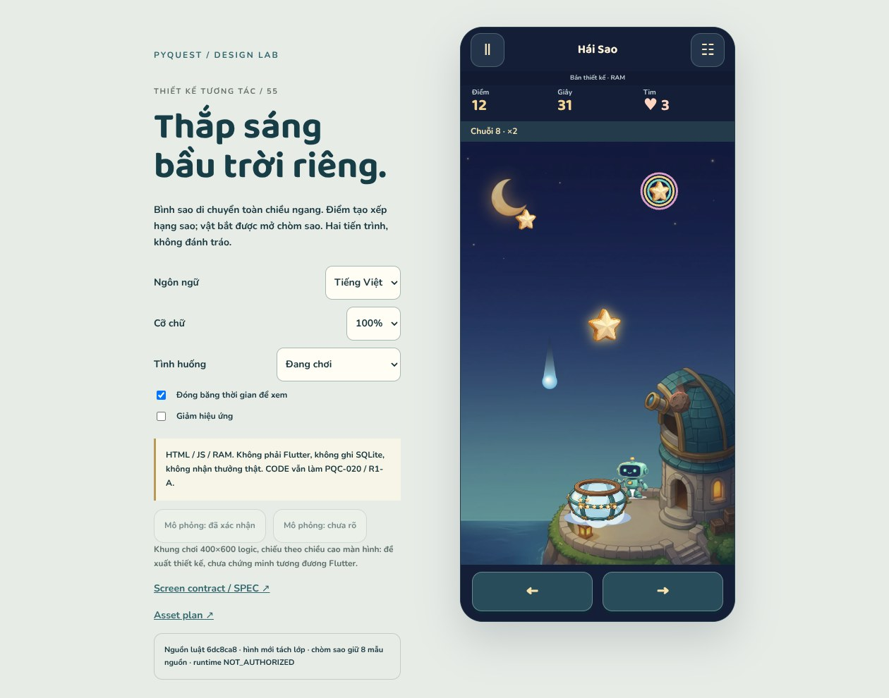

# Hái Sao / Catch Stars — gameplay & atlas r55

**2026-10-18 · DESIGN_STUDY_DELIVERED · runtime NOT_AUTHORIZED.**

Tiếp tục theo yêu cầu “chưa chuyển tin, thiết kế tiếp”. Không chờ hoặc nhận rằng
relay r54 đã gửi. CODE vẫn sở hữu PQC-020; không giao thêm Catch implementation.



## Có gì để xem và chơi

[Open study](index.html): Home → dùng 2 năng lượng → ready → tap/drag hoặc ← →
→ lượt 45 giây, 3 tim → kết quả → atlas/chơi lại. Có pause/resume/finish, năm loại
vật rơi, chuỗi tối đa ×6; chưa đạt mốc điểm vẫn có thể mở chòm sao.

Tám chòm sao nguồn, truyện locked/lit, kỷ lục first/better/tie/lower và các trạng
thái năng lượng/ghi nhận kết quả. Dữ liệu toàn RAM, tải lại trang sẽ mất.

Bốn ảnh nguồn mới, tổng cộng tám file art gồm exports; Robo tái sử dụng identity
r50. Comet/rainbow dùng procedural drawing, **không phải năm sprite mới**.
[Asset plan](ASSET_PLAN.md) ghi rõ jar proxy, alpha matte và phần production còn thiếu.

### Chạy

```sh
python3 tools/design/serve_art_review.py --port 8013 --landing r55
```

Server bind `0.0.0.0`, chỉ phục vụ các thư mục art/docs/fonts được cho phép;
browser dùng relative URLs. Mở `/docs/design/catch-stars-r55/index.html` với query:
`?state=rainbow&lang=vi&scale=1.3&freeze=1`. Có 20 tình huống trong menu công cụ.

- Phone: dùng nút ☷ để đổi ngôn ngữ/cỡ chữ/tình huống hoặc mô phỏng phản hồi lưu.
  Mở công cụ trong lượt sẽ tạm dừng.
- Để chơi live, bỏ freeze hoặc dùng URL không có `freeze=1`.
- Escape: tạm dừng. ← →: dịch bình. Tab: chuyển focus.
- Panel hướng dẫn ready cuộn được ở chữ 200%; hai nút di chuyển nằm ngoài panel.

### Kiểm chứng lại

Cần Node, Python/Pillow và Playwright/Chromium. Study không cần Flutter SDK.

```sh
node tools/design/test_stars_r55.mjs
# Cache/toolchain hiện tại của sandbox, không phải artifact trong Git:
LD_LIBRARY_PATH=/tmp/al2023/lib NODE_PATH=/home/user/.cache/pyquest-browser/node_modules \
  node tools/design/check_stars_r55.cjs
/home/user/.cache/design-venv/bin/python tools/design/validate_stars_r55.py
```

Có thể đặt `ART_REVIEW_ORIGIN` cho browser checker. Nếu cache không còn, cài
Pillow và Playwright/Chromium trong môi trường riêng; không commit binaries.
Builder tùy chọn: `tools/design/build_stars_r55.py`; không tự generate lại ảnh AI.

## Evidence và giới hạn

- [Model receipt](evidence/model-checks.json): **32 checks**, 1.000 so sánh record,
  10.000 spawn samples. Bao gồm combo thứ 5/10, cầu vồng tự nhân đôi điểm,
  không hit invulnerability, final collision, zero-star unlock, late/double ACK
  trong RAM và energy gates.
- [Browser receipt](evidence/browser-checks.json): **240 cấu hình** = 20 tình huống
  × 360/390px × VI/EN × 1/1.3/2×. Có kiểm tra target bounds, font, overflow,
  live RAF, pointer/keyboard, pause/finish/replay, locked story/focus, receipt,
  modal return và ready panel. Counts chính xác và danh sách ảnh nằm trong receipt.
- [Static receipt](evidence/static-checks.json): tám source pins, art/reference
  hashes, catalog VI/geometry, links/evidence và phạm vi DESIGN hữu hạn.
- Đã mở xem thủ công bốn ảnh nguồn; desktop; running/ready/pause 360EN2×;
  zero-star/rainbow/hit 390VI1×; atlas-all và result-bottom 360EN2×.
  Không nói đã đọc bằng mắt toàn bộ 240 cấu hình.

**Không phải** Flutter/SQLite/device/backend/voice/award/performance proof.
JS LCG khác Dart RNG và không dùng FX random stream. Camera 600 logical units
là đề xuất, chưa chứng minh engine parity. Giao diện pending/unknown chưa phải
transaction hay durable exactly-once.

## Nguồn, quyết định, phối hợp

- [SPEC](SPEC.md): luật nguồn tách khỏi D55-P1…P5, screen/focus contract và runtime gates.
- [Source notes](SOURCE_NOTES.md), [manifest](source-manifest.json),
  [rules](rules.json), [catalog](catalog.json).
- [Partner observation](partner-observation.json): bắt đầu trên `6dc8ca8`;
  sau đó CODE đã push PQC-020 đến `e440239`. Tám file nguồn liên quan không đổi.
  Focused, normal và maintenance tại SHA quan sát đều failure; chưa nghiệm thu.
  Không suy nguyên nhân chi tiết hoặc sửa CODE từ kết quả quan sát này.
- [PQD-016](../coordination/tasks/PQD-016.md): chỉ giao DESIGN. Không sửa work order 020.

Bước tiếp: kiểm tra bàn giao 020 khi có SHA/evidence phù hợp; tiếp tục R1-B theo
roadmap, không tự mở runtime house/Catch từ study này. Không có watcher hoặc
relay đã gửi tự động. **Toàn app chưa hoàn tất redesign.**
