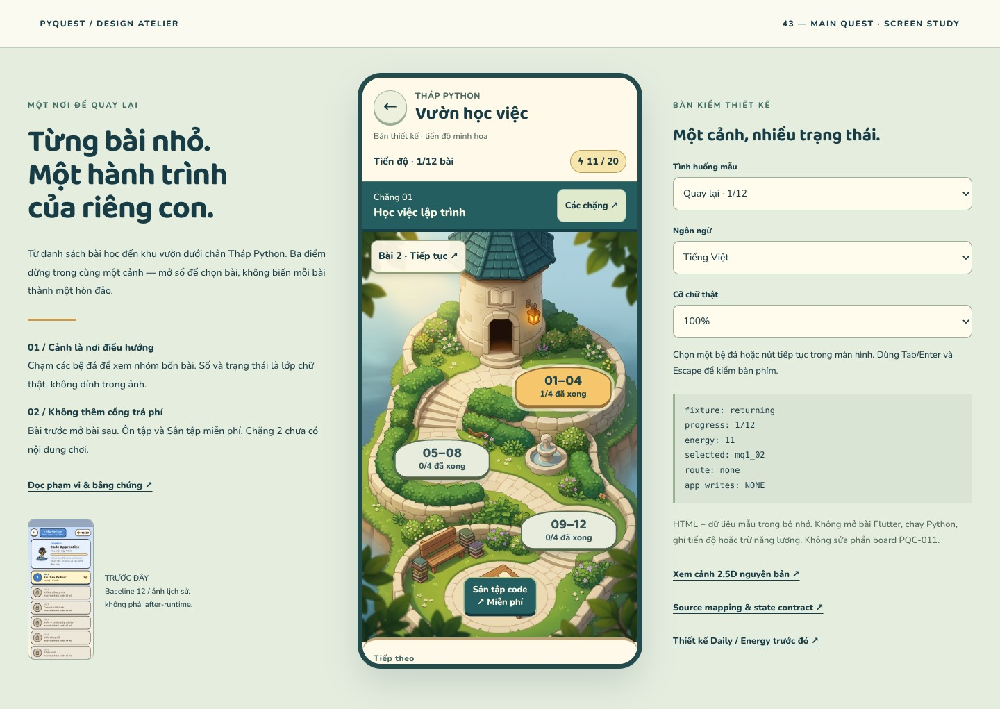

# r43 — Vườn học việc / chọn chặng và bài Main Quest

**2026-10-18 · DESIGN_STUDY_DELIVERED · không phải UI Flutter đã triển khai.**



[Mở bản tương tác](index.html) · [Cảnh nguyên bản](assets/tower-garden.png) ·
[Hợp đồng màn hình](SPEC.md) · [Kế hoạch asset production](ASSET_PLAN.md) ·
[Tình trạng thiết kế toàn app](../VISUAL_DESIGN_STATUS.md)

## Phần vừa hoàn thành

- Một cảnh **Vườn học việc bên Tháp Python**, cùng vật liệu/ánh sáng với W01 r33:
  đá ấm, mái teal, đường bậc thềm nối ba bệ đá, bàn Sân tập ở cuối vườn.
- Bệ đá là điểm điều hướng thật trong prototype. Ba nhóm **1–4 / 5–8 / 9–12**
  chỉ chia cách xem 12 bài hiện có, không thêm chặng, phí hay điều kiện khóa.
- Nút tiếp tục ngay trong cảnh dẫn tới bài kế tiếp; sổ chọn bài, lý do khóa,
  lối tới bài tiên quyết, ôn miễn phí, thiếu/chưa biết năng lượng, loading/error,
  giới thiệu chặng2 chưa phát hành và trạng thái hoàn thành.
- Chữ/nút/tiến độ tách khỏi artwork; VI/EN, phóng chữ thật 1/1.3/2×, bàn phím,
  Escape và focus quay về nút mở sổ. Nút mở Sân tập không biến thành cổng trả phí.

## Nguồn và dữ liệu

CODE pin `2ea5e5004e98df4aec8c1132a56b8d60bf4ddf5e`;
[7 source pins](source-manifest.json). Tiêu đề VI, kỹ năng, số bước, challenge flag
của12bài lấy đúng `main_quest_ch1.json`. EN là **bản dịch thiết kế**, không phải đã
được đưa vào localization Flutter. Tutor names theo skill mapping trong CastRegistry,
không suy mọi bài đều do Robo dạy. Không thay nội dung lesson/board PQC-011.

Cuối lượt phát hiện CODE `71b0fd3fd8fb07c73596ce089fa2e68f6fe87964` (correction
R42-A/B): delta chỉ integration test +task011; bảy source pins của study vẫn nguyên
byte. Chỉ kiểm scope/nguồn để bảo vệ thiết kế, **chưa review/accept correction đó**.

Các trạng thái tiến độ/năng lượng là **fixture**, không đọc tài khoản: 0/1/6/11/12
bài hoàn thành; năng lượng0/3/9/11/16 tùy tình huống. Cap20; mẫu đã xong chặng là25
(theo cấu hình +5), không phát thưởng thật. Source chỉ có một chặng chơi được;
Game Builder là metadata cho bản cập nhật sau, không có nút mở giả.

## Kiểm tra đã thực chạy

| Kiểm tra | Kết quả | Giới hạn |
|---|---:|---|
| JS model | **17 checks PASS** | Model của design study, không Dart/SQLite/engine |
| Chromium153 | **168/168 cases PASS** | 14 fixtures ×2viewport ×2locale ×3scale |
| Font scaling | **2.340 assertions PASS** | Cỡ chữ computed thực tăng, không chỉ zoom ảnh |
| Interaction | **15 flows PASS** | Tap thật, keyboard, focus, không write app |
| Captures | **13 ảnh** | 12 phone PNG +1desktop JPG, không APK |
| Source/static | Xem [receipt](evidence/static-checks.json) | Pins/byte hashes/catalog/links/scope, không Flutter |

[Model receipt](evidence/model-checks.json) · [Browser receipt](evidence/browser-checks.json).
Không overflow ngang/page dọc ngoài scroll owner, không target<48px, không overlap
các scene controls, không page error/external requests trong matrix.
Đã kiểm tap cả ba bệ + bàn Sân tập ở2× choVI/EN×hai size. 360EN2× cũng kiểm
Continue→entry preview và lối miễn phí khi hết năng lượng.

Đã mở kiểm trực quan cảnh gốc, desktop, challenge, EN2× màn đầu và thông báo thiếu
năng lượng; xem thêm ảnh controls bên dưới. Không tuyên bố đã nhìn thủ công cả168case.
Trong quá trình kiểm đã sửa: selector vị trí phụ thuộc thứ tự button gây bệ3 lệch;
text nút Chặng thiếu contrast; nhãn Sân tập chồng bệ cuối ở2×. Không giảm font để né.

## Xem các trạng thái chính

- [Về lại vườn](evidence/returning-390-vi-1x.png)
- [Giữa chặng](evidence/midway-390-vi-1x.png)
- [Thử thách cuối chặng](evidence/challenge-390-vi-1x.png)
- [Lý do khóa bài](evidence/locked-390-vi-1x.png)
- [Hoàn thành chặng](evidence/chapter_done-390-vi-1x.png)
- [Chặng tiếp theo chưa phát hành](evidence/next_chapter-390-vi-1x.png)
- [Thông báo thiếu năng lượng EN2×](evidence/energy_empty-360-en-2x.png)
- [Các nút miễn phí EN2×, sau cuộn](evidence/energy_empty-actions-360-en-2x.png)

## Chạy lại

```sh
python tools/design/serve_art_review.py --port 8005 --landing r43
node tools/design/test_chapter_r43.cjs
# Cần playwright-core và Chromium tương thích đã có trong môi trường design:
node tools/design/check_chapter_r43.cjs
python tools/design/validate_chapter_r43.py
```

`?phone=1` ẩn bàn kiểm bên ngoài, không đổi hành vi fixture. Chọn tình huống và
VI/EN/cỡ chữ từ bàn kiểm desktop; locale/cỡ chữ không reset tiến độ hoặc bài đang chọn.
Retry lỗi tải chỉ đổi về chờ dữ liệu; dùng bàn kiểm để chọn snapshot đã tải, không
fake success tự động. Mọi nút ra lesson/playground/village/recap đều dừng ở màn
**xem trước lối vào**, không gọi route hoặc tiêu năng lượng thật.

## Chưa hoàn tất / không được suy diễn

Ảnh là concept opaque848×1264, không có alpha layers/rig/navigation/camera calibration.
Study có màn và interaction thật trong HTML, nhưng không phải runtime art pack.
Không thêm SDK/deps/CI, không sửa app; không mở lại018 hoặc nghiệm thu011.
R42 vẫn là review hiện hành của011. Hai JPEG r33 dirty từ trước không được dùng làm
reference hay stage. W01 reference giữ nguyên. r41 audit/captures giữ lịch sử nguyên vẹn.

**Phần hình ảnh tiếp theo:** chọn màn Maze, rồi Maze Creator grid/brush/test thực sự.
Các màn partial và production export vẫn nằm trong bảng tình trạng toàn app; không
lấy slice này để tuyên bố toàn bộ thiết kế đã xong.
