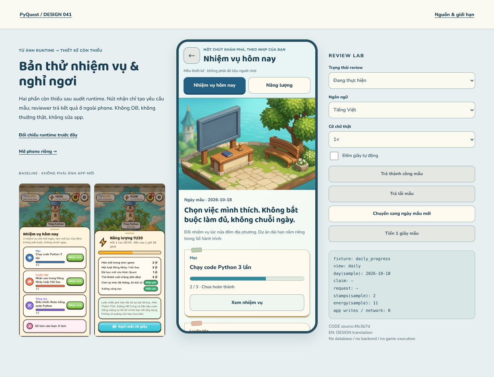

# R41 — Nhiệm vụ hôm nay & năng lượng / nghỉ mắt

**Bản thử thiết kế HTML, không phải Flutter runtime.**
[Chơi thử](index.html?lang=vi) · [Phone riêng](index.html?phone=1&lang=vi) ·
[Đối chiếu runtime](../runtime-gap-r41/index.html) · [Spec/giới hạn](SPEC.md).



## Đã làm mới

- **Cảnh quầy nhiệm vụ và ghế nghỉ2,5D**, neo vật liệu/ánh sáng W01; chữ, progress,
  số tem và trạng thái nằm ngoài ảnh. Không đổi ảnh canonical.
- **Nhiệm vụ hôm nay:** ba loại học/luyện/sáng tạo, chi tiết, chưa xong/có tem/
  pending/error/đã nhận mẫu, load/error và ngày mới. Daily không phải Sổ hành trình.
- **Năng lượng:** rõ số mẫu và phần miễn phí; bảng chi phí theo config, full/empty/
  unknown; không mua năng lượng hoặc gắn bonus vào nghỉ mắt.
- **Nghỉ mắt20giây:** đồng hồlocal códừng, không cộngtem/nănglượng và không phátâmthanh.

### Cách thử

1. Chạm “Xem nhiệm vụ” → quay lại; đổi VI/EN/cỡ chữ1–2× ngoài phone.
2. Chọn fixture “Có tem để nhận”, bấm “Thử nhận tem mẫu”. Nó sẽ chờ; dùng nút
   **Trả thành công mẫu / Trả lỗi mẫu** ở REVIEW LAB, không phải backend thật.
3. Thử pending rồi đổi ngày mẫu: responsecũ không tăngtem ngày mới. Đây chỉ là
   reducer fixture; không chứng nhận engine/repository trongapp.
4. Chuyển Năng lượng, xem bảng chi phí; thử0/20vàloading/error. Chọn Nghỉ mắt,
   cóthểdừng sớm. Không gắn phần thưởng với timer.

## Kết quả đã kiểm

| Phạm vi | Kết quả |
|---|---:|
|16fixtures×2phones×VI/EN×1/1.3/2× |192/192 |
|Computed-font comparisons |3,624đạt |
|Browser interaction flows |11đạt |
|Model/source invariants |17đạt |
|Overflow, browser/request errors, external requests |0 |

[Browser receipt](evidence/browser-checks.json) · [Model receipt](evidence/model-checks.json) ·
[Source pins](source-manifest.json) · [Manifest](manifest.json).

Đã mở cảnh full-size và ảnh chụp đại diện: [daily](evidence/daily_progress-390-vi-1x.png),
[claim](evidence/daily_claimable-390-vi-1x.png), [energy](evidence/energy_partial-390-vi-1x.png),
[break](evidence/break_active-390-vi-1x.png), [EN2×](evidence/daily_progress-360-en-2x.png).
Không tuyên bố đã xem thủ công192cases hoặc đã kiểmscreen-reader/thiết bị thật.

## Nguồn và ranh giới

PinCODE4fe3b7d:8dailyquest definitions,3categories,energyconfig vàcosts hiện có.
VI titleexactsource; ENdịchDESIGN. Sample2tem/11energy/ngày18–19khôngphải dữliệungườixem
hoặc kết quảdaily picker thật. Source khác display/copy ởđâu đã ghi trongSPEC.
Không DB, localStorage, server/game execution, appaward, spend, publish hoặc ad.

Tác vụ[**PQD-006**](../coordination/tasks/PQD-006.md) củaDESIGN. Không chạm011/018,
app/CI/deps, W08/W14 hoặc packageCODE. Không giao thêm việcCODE qua prototype này.

```sh
python tools/design/serve_art_review.py --port 8004 --landing r41
node tools/design/test_daily_r41.cjs
NODE_PATH=/home/user/.cache/pyquest-r34-browser/node_modules \
LD_LIBRARY_PATH=/home/user/.cache/pyquest-r34-browser/libs/lib \
node tools/design/check_daily_r41.cjs
python tools/design/validate_gap_r41.py
```

Static validator kiểm source/assets/38baseline/coverage/protectedscope as-of delivery;
không gọi HTML evidence là Flutter tests. Live preview vào bảng audit, có nút mở
prototype bên cạnh runtimebaseline để nhìn rõ trước/sau **về thiết kế**.
