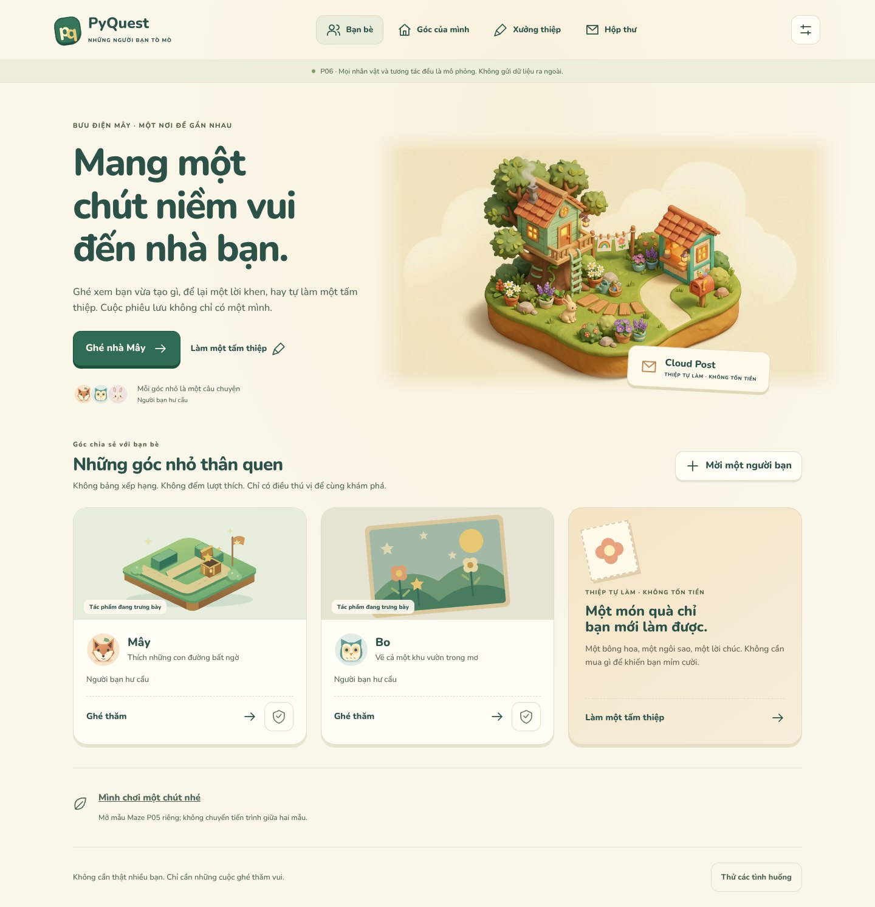

# P06 · Bưu điện Mây

**Một nơi đem điều mình làm được đến chia sẻ, không chỉ một danh sách bạn bè.**

Ngày: 2026-10-16 · **Prototype thiết kế tương tác, chưa tích hợp Flutter.**
Nguồn sản phẩm: [PRODUCT_VISION §16](../../PRODUCT_VISION.md#16-cộng-đồng-bạn-bè-và-quà-tặng).
Gói này không mở work order runtime, không đổi quyền PQC-010/014/015.

**Bổ sung sau bàn giao `62627d5`:** đây là **lớp P06 A**, chưa phải toàn bộ không gian
xã hội. [Thiết kế P06B](../experience-blueprint/P06B_LIVING_HOMES_ISLANDS_PETS.md) giữ
mở rộng nhà/đất/đảo, thăm nhà có hoạt động chung, mua thú thông minh và hướng AI local
như các trụ cột sản phẩm. P06B chưa có prototype; không coi profile hiện tại là thăm
nhà multiplayer, hay lời thoại soạn sẵn là local AI.



## Bấm thử

Từ root repository:

```sh
python3 tools/design/serve_friends.py --port 8003
```

Mở preview của cổng **8003**, đường dẫn `/friends-showcase-prototype/`.
Server bind `0.0.0.0`, root tự chuyển tới P06, không cần build hoặc CDN.
Không mở `index.html` bằng `file://` vì mẫu dùng ES modules.

### Chuyến ghé thăm khoảng 3 phút

1. **Ghé nhà Mây → Mở tác phẩm → Để lại lời khen.** Chọn điều bạn thích, không đếm lượt thích.
2. **Rủ bạn chơi cùng.** Lời mời xuất hiện ở hộp thư mẫu; chưa có phòng chơi, đối thủ hay trận thật.
3. **Xưởng thiệp:** chọn giấy, chọn nhãn dán, chạm 6 ô để đặt/bỏ; thử đổi lời chúc và hoàn tác.
4. **Xem trước tặng bạn:** chọn người nhận rồi đặt vào hộp thư mẫu.
5. **Thử các phản hồi mẫu:** mô phỏng lỗi → thử lại cùng thư, nhận thư hoặc từ chối. Không tự nhận thành công.
6. **Góc của mình:** xem như một người bạn. Mặc định riêng tư nên chưa thấy món nào; đổi sang bạn bè đã đồng ý, rồi thử cất một tác phẩm khỏi kệ.
7. **Mời một người bạn:** chỉ mã hư cấu `LA006` tìm được Lá. Tạo lời mời chưa tạo tình bạn; phản hồi được giả lập riêng ở bàn thử.
8. Nút khiên ở thẻ bạn hoặc **Chặn / báo cáo** trong hồ sơ luôn dẫn tới hành động an toàn. Báo cáo vẫn mở được sau khi chặn.

**Cài đặt:** Theo hệ thống / Tiếng Việt / English; chữ 100 / 130 / 200%; ít chuyển động.
Đổi ngôn ngữ không đặt lại thiệp hoặc thư đang chờ. Chỉ lựa chọn ngôn ngữ được lưu;
mọi dữ liệu xã hội và thiệp mất khi tải lại. Không có nút mua hàng, gửi thư thật hay truy cập danh bạ.

## Điểm nhấn thiết kế

- **Một khu vườn sáng tạo 2.5D:** nhà cây, bưu điện, giấy màu và các dấu hiệu có thể chạm; không biến sân bạn bè thành bảng quản trị.
- **Mỗi bạn có một điều để khám phá:** Mây thích mê cung, Bo vẽ vườn sao, Lá làm thiệp. Tên riêng không tự dịch.
- **Xưởng thiệp là hoạt động thật trong mẫu:** phối 3 giấy × 4 nhãn dán × 6 vị trí × 3 lời chúc, có bỏ nhãn và hoàn tác. Không phải ảnh tĩnh giả làm công cụ vẽ.
- **Hai ngăn khác nhau:** huy hiệu thành tích chứng minh điều đã làm; thiệp/lời khen là kỷ niệm. Không mua hoặc tặng được kỹ năng/thứ hạng.
- **Không có bạn vẫn có chỗ chơi:** xưởng riêng, kệ riêng và đường sang mẫu Maze P05 độc lập. Không chuyển tiến trình giữa hai prototype.
- **Có quyền không đáp lễ:** từ chối thiệp không trừ điểm, không hủy tình bạn, không yêu cầu bù bằng quà khác.

“Không bảng xếp hạng” trong sân bạn bè nghĩa là **không xếp hạng độ nổi tiếng**.
Arena/Creator League và bảng hạng theo kết quả thi đấu vẫn thuộc P07, không bị loại bỏ.

## Gói bàn giao

| Tệp | Dùng để làm gì |
|---|---|
| [DESIGN.md](DESIGN.md) | Creative direction, wireflow, vai trò từng màn, state matrix và những nhánh tương lai được giữ lại |
| [IMPLEMENTATION_NOTES.md](IMPLEMENTATION_NOTES.md) | Hợp đồng hành vi, dữ liệu đề xuất, ranh giới quyền, a11y/l10n và prompt bàn giao cho code |
| `index.html`, `style.css`, `app.mjs` | Giao diện chạy được, điều hướng và dialog tương tác |
| `social-model.mjs` | Mô hình giả lập thuần, không gọi server |
| `copy.mjs` | Copy VI/EN theo semantic ID, kiểm tham số thiếu |
| `art/`, [manifest.json](manifest.json) | Tranh gốc, SVG mới, nguồn tái sử dụng, kích thước và hash |
| [evidence/README.md](evidence/README.md) | Danh mục ảnh, kết quả và giới hạn kiểm chứng |
| [browser-check.json](evidence/browser-check.json) | Receipt kiểm trình duyệt, 414 cấu hình bố cục, 18 lượt axe |

## 12 tình huống

`default` · `empty` · `incoming` · `outgoing` · `offline` · `limited` · `private` ·
`moderation` · `pending` · `failed` · `blocked` · `declined`.

Mở **Thử các tình huống** ở chân trang để chọn. Nạp một tình huống **đặt lại phiên mẫu**;
đây là bàn thử cho người review, không phải quyền của trẻ trong sản phẩm thật.

## Đã kiểm tra

- **21/21** bài kiểm Node: model, ranh giới hiển thị, chống trùng trong phiên, copy và hash nguồn.
- **414** cấu hình trình duyệt: 216 fixture + 126 route + 72 dialog; VI/EN × chữ 1/1.3/2 × 1440×1080, 390×844, 360×640.
- Luồng kết bạn/thiệp/lời khen/chặn/báo cáo; bàn phím Tab/Shift+Tab/Enter/Space/Escape; focus sau điều hướng/dialog; chế độ ít chuyển động.
- Nút/select hiển thị cao và rộng tối thiểu 48 CSS px; không phát hiện tràn trang hoặc cắt chữ ở các phần tử đo.
- **18 lượt axe**, không có violation tự động trong các tag đã chạy. Một số contrast trên nền gradient/ảnh còn `incomplete`; **không phải chứng nhận WCAG**.
- 12 ảnh desktop/phone trong `evidence/`; không lỗi JS/HTTP, không request ngoài origin, không request ghi dữ liệu trong luồng kiểm.

Chạy lại:

```sh
node --test tools/design/test_friends.mjs
# Cài các dependency kiểm vào cache, không thêm vào runtime app:
npm install --prefix /home/user/.cache/p06-review playwright-core @sparticuz/chromium @axe-core/playwright@4.10.2
NODE_PATH=/home/user/.cache/p06-review/node_modules node tools/design/smoke_friends.cjs
```

Trong sandbox hiện tại dùng các dependency Chromium/Playwright của P05 và thư viện NSPR/NSS đã chuẩn bị:

```sh
LD_LIBRARY_PATH=/home/user/.cache/p05-review/libs/lib \
NODE_PATH=/home/user/.cache/p05-review/node_modules:/home/user/.cache/p06-review/node_modules \
node tools/design/smoke_friends.cjs
```

Có thể đặt `GALLERY_URL`, `EVIDENCE_DIR`, `BROWSER_EXECUTABLE_PATH` để dùng môi trường khác.
Bản kiểm đã chạy bằng Chromium **153.0.8010.0**, axe-core **4.10.3** qua wrapper Playwright 4.10.2.

## Chưa được coi là đã làm

Không có identity, parental consent, quyền server, kiểm duyệt, lưu tác phẩm thật,
nhận/gửi thư thật, thực thi UGC, ghép trận, thanh toán hoặc cấp thưởng. Màn hộp thư
hiện là **phía người gửi**, kết quả phía nhận chỉ do bàn thử mô phỏng.
Chưa kiểm với trẻ em, thiết bị thật, TalkBack/VoiceOver, Safari/Firefox hay Flutter textScaler.

Đội nhóm, triển lãm, quà mua sẵn, danh hiệu xã hội, tranh tự vẽ, album và quà lập trình
**vẫn còn trong tầm nhìn §16**; xem lộ trình trong DESIGN, không suy ra rằng mẫu thiệp này thay thế toàn bộ roadmap.
