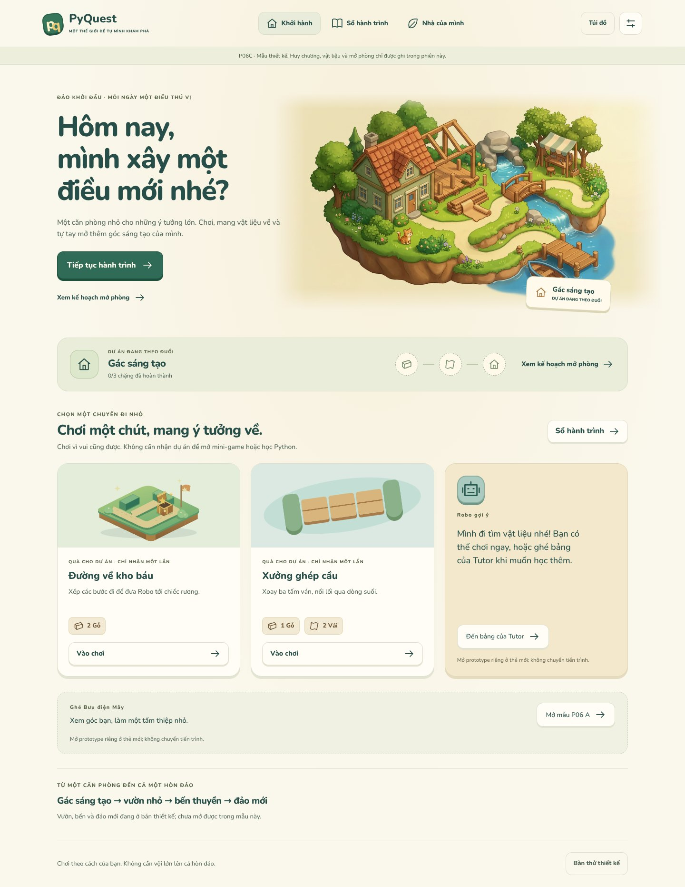

# P06C — Màn chính và hành trình mở một căn phòng

2026-10-16 · **Prototype thiết kế tương tác**, tiếp nối P06 A và định hướng nhà/đất/đảo P06B.
Không mở rộng quyền runtime PQC-010/014/015. Không tích hợp Flutter/backend/economy.



## Một chuỗi việc có ý nghĩa, không phải các màn rời nhau

```text
Màn chính → kế hoạch Gác sáng tạo → biết còn thiếu gì
                 ├─ Đường về kho báu → thắng → nhận 2 gỗ
                 └─ Xưởng ghép cầu   → thắng → nhận 1 gỗ + 2 vải
                     lần thắng đầu được nhận: huy chương First Steps
                                         ↓
                 đủ huy chương AND 3 gỗ AND 2 vải
                                         ↓
             xem trước → xác nhận → phản hồi giao dịch mẫu
                 ├─ lỗi: giữ nguyên vật liệu, có thử lại
                 └─ thành công: dùng vật liệu, GIỮ huy chương
                                         ↓
                    vào phòng mới → bàn sáng tạo / chơi tiếp
```

**Các số 3 gỗ/2 vải và phần thưởng vật liệu là định mức thiết kế minh họa**, chưa là
luật kinh tế app. Huy chương không phải vật liệu tiêu hao, không mua thay bằng gỗ.
Hai trò mở ngay từ đầu, chơi theo thứ tự nào cũng được. Main Quest/Tutor không bị
khóa sau căn phòng; người không thích xây nhà vẫn chơi được.

## Chạy mẫu

```sh
python3 tools/design/serve_home.py --port 8004
```

Mở live preview cổng **8004**, `/home-journey-prototype/` (root tự redirect).
ES modules cần HTTP, không mở bằng `file://`. Server chỉ serve `docs/design`, bind `0.0.0.0`.

### Thử trong vài phút

1. Màn **Khởi hành** cho thấy dự án đang theo, hai mini-game và đường tới bảng Tutor.
2. **Nhà của mình** cho thấy phòng dự kiến và từng điều kiện còn thiếu, kèm nguồn kiếm/nút đi đúng hoạt động.
3. **Đường về kho báu:** thêm bốn bước **Phải**, chạy thử. Có thể thử đi Lên để xem thất bại rồi sửa lại.
4. **Xưởng ghép cầu:** chạm ván 1 và 3 để cả ba nằm ngang, rồi thử cầu.
5. Nhận vật liệu sau mỗi lần thắng, hoặc để cả hai kết quả chờ rồi nhận qua **Sổ hành trình**. Chuyển màn không làm mất kết quả chờ nhận.
6. Trở lại nhà: xem trước → xác nhận. **Pending chưa tiêu vật liệu.** Chọn phản hồi giả lập thành công hoặc lỗi để thử.
7. Thành công: túi còn 0 gỗ/0 vải, huy chương vẫn còn; phòng mới mở, nhật ký ghi đúng một giao dịch xây.

**Túi đồ** cho biết tồn kho, huy chương và nguồn vật liệu/giao dịch. **Bàn thử thiết kế**
có 7 fixture và nút giả lập kết nối không đặt lại phiên. Nạp fixture khác thì reset
rõ ràng. Ngôn ngữ theo system/VI/EN, chữ 100/130/200%, ít chuyển động.

## Đã có trong gói này

| Màn | Vai trò |
|---|---|
| Khởi hành | Màn chính 2.5D, dự án đang theo và những cách chơi vẫn mở |
| Kế hoạch nhà | Xem phòng, huy chương/vật liệu, thiếu bao nhiêu và kiếm ở đâu |
| Sổ hành trình | Hai công việc độc lập cùng dẫn tới một mục tiêu; pending/received rõ |
| Đường về kho báu | Trò Maze có kết quả tính từ lệnh; dùng geometry `rm_01` và simulator prototype đã có |
| Xưởng ghép cầu | Mini-game thiết kế mới: xoay ba ván; tính đường nối từ orientation thực |
| Kết quả | Thắng/chưa đạt, nhận phần thưởng dự án, sửa tiếp hoặc quay về nhà |
| Gác đã mở | Màn nội thất mới, entry bàn sáng tạo và phản hồi mèo soạn sẵn |
| Các dialog | Túi/nhật ký, xác nhận xây, cài đặt |

Hình hero mới do AI tạo, 1376×768; WebP cùng tỷ lệ. Nội thất là SVG cutaway mới.
Hero không phải bản đồ đi lại/hotspot; mèo trong tranh không chạy AI.
Nhánh Tutor/P06 A mở prototype riêng ở tab mới, có nhãn **không chuyển tiến trình**.

## Handoff và bằng chứng

- [DESIGN_AND_HANDOFF.md](DESIGN_AND_HANDOFF.md): hợp đồng tiến trình, nguồn thưởng, giới hạn và các bước thiết kế tiếp.
- [journey-spec.json](journey-spec.json): dependency graph đề xuất, không vòng khóa; model được unit-test khớp định mức.
- [manifest.json](manifest.json): nguồn, provenance, hash và định mức mẫu; không phải art/economy approval.
- [evidence/README.md](evidence/README.md): 12 ảnh và scope kiểm chứng.
- [model-tests.tap](evidence/model-tests.tap): **20/20 PASS**.
- [browser-check.json](evidence/browser-check.json): **324** layout checks, **15** audit axe, các luồng thật qua UI.

```sh
node --test tools/design/test_home.mjs
# Dùng cache Playwright/Chromium và axe đã chuẩn bị trong sandbox:
LD_LIBRARY_PATH=/home/user/.cache/p05-review/libs/lib \
NODE_PATH=/home/user/.cache/p05-review/node_modules:/home/user/.cache/p06-review/node_modules \
node tools/design/smoke_home.cjs
```

Ở môi trường khác, cài `playwright-core`, `@sparticuz/chromium`, `@axe-core/playwright@4.10.2`
vào thư mục kiểm riêng, trỏ `NODE_PATH`; có thể đặt `BROWSER_EXECUTABLE_PATH`, `GALLERY_URL`,
`EVIDENCE_DIR`. Không thêm dependency kiểm vào app Flutter.

## Chưa làm — không gộp vào tuyên bố hoàn thành

Chưa có lưu tiến trình bền vững, giao dịch server, năng lượng/thưởng app, chỉnh nội thất,
nhân vật đi lại, ghé nhà đồng bộ, mở vườn/đất/bến/đảo, mua thú hoặc local inference.
Mèo chỉ có lời đáp authored, không phải AI. Chỉ locale được lưu; reload mất toàn bộ
trạng thái mẫu. Không có countdown xây dựng, tiền thật hoặc quảng cáo.

324 layout checks kiểm HTML ở 1440×1080, 390×844, 360×640; VI/EN; chữ 1/1.3/2. Không phải
Flutter textScaler/thiết bị thật/TalkBack/VoiceOver/user research. Axe không phát hiện
violation trong các audit đã chạy nhưng còn `incomplete` trên nền ảnh/gradient; không
phải chứng nhận WCAG. Scope browser receipt chỉ áp dụng gói này, không P06B multiplayer/AI.
