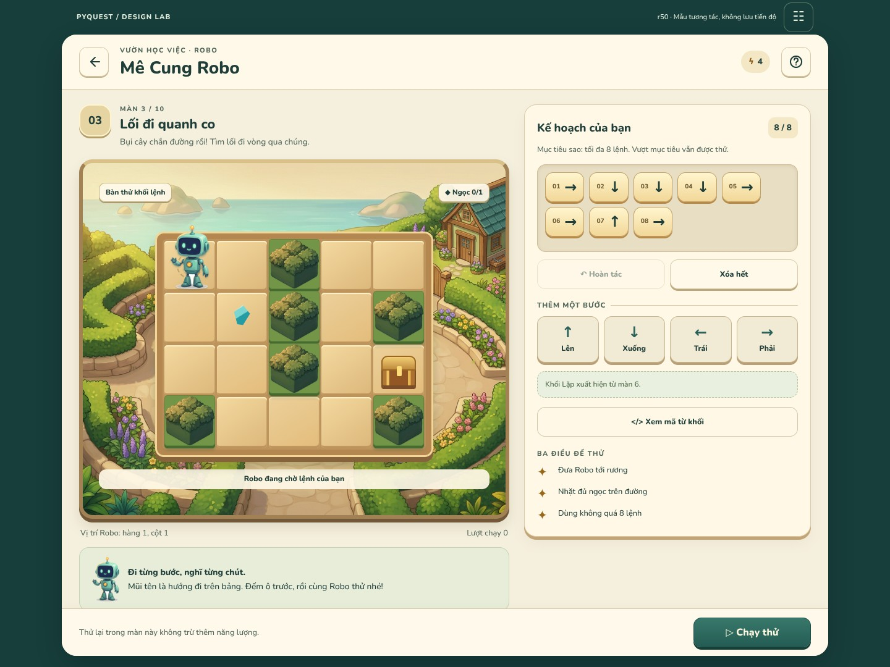

# r50 — Cùng Robo tìm đường · gameplay & kết quả

**2026-10-18 · DESIGN_STUDY_DELIVERED · runtime NOT_AUTHORIZED**



[Mở bản tương tác](index.html) · [Spec/source vs proposal](SPEC.md) ·
[Artwork & production gaps](ASSET_PLAN.md) · [Source pins](source-manifest.json)

## Phần mới, độc lập với CODE

Một sân chơi cùng thế giới W01/r45, Robo mới có khối, bàn mê cung vật liệu gỗ/đất
và bụi cây mới. Đây là **màn chơi có thể thao tác**, không phải thêm một thumbnail
hoặc dùng ảnh chứa sẵn đường đi làm gameplay.

- Xếp/sắp lại/bỏ lệnh, undo và clear có xác nhận; repeat2–9, mở lại/chỉnh body.
- Chạy JS thật từ các lệnh: pause, từng bước, tiếp tục, dừng; hướng/block đang
  chạy hiện trên board, lỗi chỉ đúng block khi trở về sửa kế hoạch.
- Các tình huống tường/nước/mép bảng/hết lệnh; kết quả1/2/3sao theo ba mục tiêu
  độc lập. Màn không có ngọc được xử lý đúng, không dựng một sao bất khả thi.
- Kết quả có pending/lỗi/thử xác nhận lại; không tự mở màn kế trước khi ack.
  Năng lượng chưa đọc được khác hết năng lượng; thử lại màn hiện tại miễn phí.
- Kết quả cuối vườn quay về sổ màn hoặc ghé Creator, không tự mở đảo/reward mới.
- Xem mã Python từ khối ở chế độ đọc, **không giả có trình chạy Python**.

## Thử nhanh trong Live Preview

1. Bấm **Xếp lệnh cho Robo**, chạm mũi tên. Chọn một block để đổi vị trí hoặc bỏ.
2. Bấm **Chạy thử**: màn cuộn về board. Có thể **Tạm dừng → Một bước**, rồi tiếp
   tục hoặc dừng để sửa. Lỗi không xóa kế hoạch của bạn.
3. Bàn kiểm **☷** ở thanh trên cùng (không thuộc UI sản phẩm) cho chọn VI/EN,
   cỡ chữ100/130/200% và19tình huống. Chọn `assembled` rồi Chạy để xem một lượt
   hoàn chỉnh; `open_loop` để sửa khối lặp, `save_error` để thử xác nhận lại.
4. `energy_unknown`/`energy_empty` phân biệt thiếu dữ liệu/thiếu năng lượng;
   `final_win` là kết quả màn10. Không dùng reviewer để giả state đã lưu thật.

Back dẫn về [chọn màn r45](../maze-trail-r45/index.html); cuối vườn có đường tới
[Creator r46](../maze-creator-r46/index.html). **Các study không trao đổi dữ liệu
qua trang**; r45 vẫn là snapshot độc lập, chưa tự nối router runtime.

## Kiểm tra đã thực chạy

| Kiểm tra HTML/JS | Kết quả |
|---|---:|
| [Model](evidence/model-checks.json) | **28checks +500random programs PASS** |
| [Browser Chromium153](evidence/browser-checks.json) | **324/324cases PASS** |
| Font proportional assertions | **3.732** |
| Interaction flows | **17PASS** |
| Captures | **13** (12phonePNG +desktopJPEG) |
| Source/static checks | [receipt](evidence/static-checks.json) |

Matrix: (19states +8secondarydialogs)×360×640/390×844×VI/EN×100/130/200%.
Không phát hiện horizontal/pagevertical overflow, controls dưới48px, button
collisions, page errors hoặc request ngoài origin trong matrix này. Tap thật
ở200%, focus/Escape, record retry, next-cost, loop edit và reduced-motion đã kiểm.
CSS smooth scroll tắt riêng khi capture để không chụp giữa hành trình cuộn.

Đã mở xem W01, r34Maze, r45garden; baseline06/07/09; art mới và các capture desktop,
readyVI, result3star, editorEN200%, energyEN200%. Không claim xem thủ công mọi case.
Đã sửa font URL404, giảm chi tiết hedge ởsize nhỏ, tránh capture giữa smooth scroll
và reflow header200%; không sửa app hoặc thay SDK để làm design tests xanh.

## Source không bị đổi thành giả định

PinCODE `de01a490743982356ad5240d77ea99e9dbf8c7f5`;10levels/246cells,
max200moves, repeat count, stars/score40–30–30 và cost2/0 giữ nguồn. 19fixtures là
**sample records**, không dữ liệu người dùng. Timer/record guards/global30command
cap là proposal, không nói Flutter đã có. XemSPEC để biết khác biệt cụ thể.

Không Flutter/Python/DB/event/reward/AI/network thực; không physicaldevice/voice
acceptance. Model so với scalar JS analogue không chứng minh Dart parity. Art mới
chưa đủ production atlas/rig/layers. Full Python editor, bestscore/reward-notice
queue và custom result vẫn là phần tiếp theo, không gọi Maze đã hoàn tất mọi mode.

## Chạy lại

```sh
python tools/design/serve_art_review.py --port 8008 --landing r50
node tools/design/test_maze_play_r50.cjs
# Môi trường design dùng playwright-core1.64.1 và @sparticuz/chromium153.0.0:
NODE_PATH=/home/user/.cache/pyquest-r50-browser/node_modules \
LD_LIBRARY_PATH=/home/user/.cache/pyquest-r50-browser/libs/lib \
node tools/design/check_maze_play_r50.cjs
python tools/design/validate_maze_play_r50.py
```

Trên Arena, server chạy bằng process tool, bind0.0.0.0, mọi asset dùng relativeURL.
Dependencies Chromium/Pillow nằm cache ngoài Git, không vào app. Cache có thể mất
ở môi trường khác; thiếu browser không được ghi tests đãPASS.

[TaskPQD-011](../coordination/tasks/PQD-011.md) ·
[Tình trạng toànapp](../VISUAL_DESIGN_STATUS.md).
PQC-011 giữ kết quả **PINNED_SDK_EXECUTED_FAILURE** theo r49/correction order đã
phát hành; study này không đóng task đó, không gọi lại “chưa có SDK”.018art không
mở lại; không giao runtime order trùng CODE, không chạm workflow hoặc key/APK.
