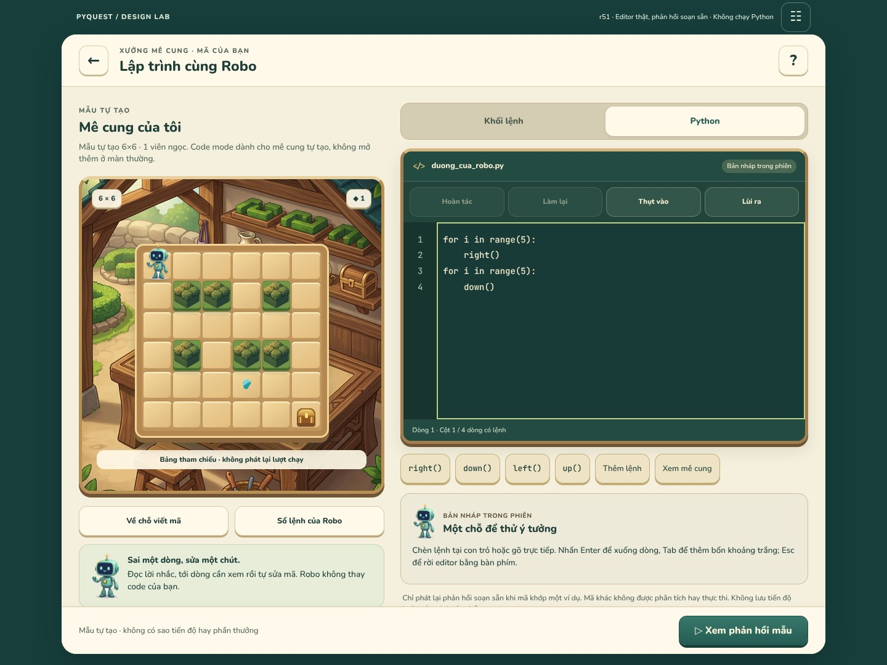

# r51 — Xưởng Python: viết mã và đọc lỗi cùng Robo

**2026-10-18 · DESIGN_STUDY_DELIVERED · HTML/JS, không phải APK.**



[Thử tương tác](index.html) · [Source/proposal contract](SPEC.md) ·
[Source excerpts](SOURCE_EXCERPTS.md) · [Asset reuse](ASSET_PLAN.md)

## Phần đã làm

- Editor textarea thật: gõ, chọn đoạn, chèn tại con trỏ, Enter/Tab/Shift+Tab,
  undo/redo, gutter số dòng và tới dòng lỗi. Esc thoát editor để tiếp tục Tab.
- Hai tab giữ bản Python riêng. Tab khối là **bản mẫu tĩnh**, không phải builder mới.
  Thay Python bằng bản dịch khối cần xác nhận, có thể hoàn tác; không parse ngược.
- Phân biệt lỗi cú pháp/tên lệnh/tập con không hỗ trợ/giới hạn, output thành công
  nhưng chưa thắng, mẫu tới rương, pending/cancelled/outdated và mã chưa có runtime.
- Giữ mã/output khi đổi VI/EN và cỡ chữ. Mobile ưu tiên editor; desktop tham chiếu
  mê cung cạnh mã. Dùng lại xưởng gỗ r46 và Robo/hàng rào r50, không tạo style mới.

## Cách xem

Chạy từ repository root:

```sh
python tools/design/serve_art_review.py --port 8009 --landing r51
```

Mở preview **Xưởng Python · editor & phản hồi lỗi**. Nút ☷ mở bàn kiểm:
chọn 14 trạng thái, VI/EN, chữ 100/130/200%, hoặc giữ pending rồi giao phản hồi.
Thử `syntax` → “Tới dòng 1” → sửa dấu `:` → “Xem phản hồi mẫu”. Mã vừa sửa không
khớp ví dụ khác sẽ báo **chưa nối runtime**, không giả vờ biên dịch thành công.
Ctrl/Cmd+Enter xem mẫu; Ctrl/Cmd+Z và Shift+Z hoàn tác/làm lại.

## Giới hạn bắt buộc

**Không có Python interpreter trong study.** Sáu chuỗi code biết trước chỉ tra
phản hồi do DESIGN soạn; so sánh chuỗi chính xác, không trim hay suy luận output.
Mã bất kỳ không bị đánh giá đúng/sai. Board không phát lại chuyển động; Robo đứng
ở vị trí tham chiếu kể cả fixture `won`. Không event, award, database, verified
record hoặc state bridge sang r45/r46/r50. Reload/rời trang mất bản nháp RAM.
Các liên kết trong trang có cảnh báo rời bản nháp; không bảo đảm chặn browser Back.

Source chỉ cho editable Python ở **mê cung tự tạo/Creator**. Màn Maze thường vẫn
là block gameplay và bản dịch Python read-only. Không mở thêm mode trái source.

## Bằng chứng

- [Model receipt](evidence/model-checks.json): **29 checks +1.000 thao tác ngẫu nhiên**.
- [Browser receipt](evidence/browser-checks.json): **252 cases**, 1.476 font assertions,
  **19 flows**, 12 captures; Chromium153.0.8010.0, 0 request/page errors, 0 external requests.
  Matrix14fixtures ×3viewports ×2locales ×3scales. Kiểm overflow ngang, font scale,
  kích thước nút và các luồng editor; không phải chứng nhận toàn bộ accessibility.
- [Static receipt](evidence/static-checks.json): source/dependency/artifact hashes,
  local links, harness provenance. [Manifest](manifest.json).
- Ảnh chữ lớn chỉ cho một phần nội dung tại một vị trí cuộn; landscape capture đã
  cuộn đến textarea, không phải chứng minh mọi control cùng hiện trên một màn.
- IME chỉ kiểm sự kiện composition tổng hợp; chưa thử bàn phím Android/iOS thật,
  screen reader, Flutter, engine hoặc thiết bị. Không lấy JS PASS làm Python parity.

Chạy lại model: `node tools/design/test_maze_python_r51.cjs`.
Browser harness: `tools/design/check_maze_python_r51.cjs`, cần `playwright-core`
1.64.1 và `@sparticuz/chromium`153.0.0 cùng system libraries phù hợp; biến
`ART_REVIEW_ORIGIN` mặc định `http://127.0.0.1:8009` chỉ dành cho test runner.
Browser-facing UI chỉ dùng URL tương đối, không gọi localhost/backend.
Static: `python tools/design/validate_maze_python_r51.py`.

## Phối hợp / chưa làm

[PQD-012](../coordination/tasks/PQD-012.md) là task DESIGN, không phải CODEPQC-011.
Không giao runtime order mới, không sửa app/CI hoặc chạy lại de01 chỉ để có ACK.
Đã chủ động nhìn nhánh CODE: tip `bcf2bfc5088ca80f1a6f0fd1d2211032f5ce416a`;
Actions39080793621 và39080793623 có kết luận failure. Đây chỉ là quan sát metadata,
**chưa review logs/source correction**, không thay bằng chứng chi tiết r49 tại de01.
Các file Maze/editor/runtime được pin ở đây không đổi giữa de01 và tip đó.
Xem [observation](partner-observation.json). Không tự nhận CODE được nghiệm thu.

Tiếp theo: Maze best-record/skill/reward notices và custom-result/verification
transaction surfaces; sprite/terrain production pack; Dragon/Stars và các nhóm
partial khác theo VISUAL_DESIGN_STATUS. R51 không làm xong toàn app.
