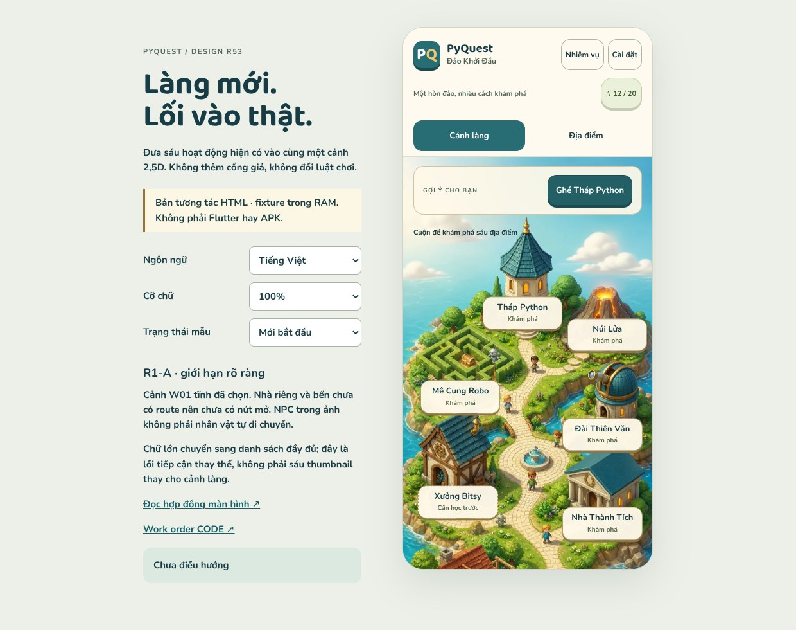

# R53 — Làng 2,5D, từ thiết kế sang sáu lối vào thật

2026-10-18 · **DESIGN package delivered; runtime020 READY_FOR_CODE, chưa triển khai.**



[Mở study](index.html) · [Screen contract](SPEC.md) · [Asset/geometry manifest](manifest.json) ·
[Work order020](../../implementation/coordination/tasks/PQC-020.md) ·
[011 đã được nhận](../coordination/reviews/PQC-011-r53/README.md)

## Quyết định

Sau gate011, mở **R1-A/Main Map** cho CODE: thay scene, marker/geometry và accessible
directory; nối sáu ActivitySheet/routes hiện có, giữ progress/gameplay. Không chỉ
làm thêm thumbnail hoặc tiếp tục vòng Tutor. R1-B sẽ nối các surface tiếp theo;
nhà–đất–đảo, NPC/pet, visit/Arena không bị xóa khỏi roadmap.

Ngoại lệ có giới hạn: W01 tĩnh đã được user chọn được exportWebP để dùng làm scene
R1-A. Không tự tuyên bố layered production pack: NPC/bóng/công trình baked, không
animation/occlusion/navmesh. Nhà riêng/bến trong ảnh chưa có route thì không có nút
mở. Đây là bước triển khai phân kỳ rõ ràng, không nhận toàn bộR1 hoặc đổi mục tiêu
thế giới tương tác thành postcard.

## Đầu ra DESIGN thật

- Cảnh giữ cùng vật liệu2,5D W01; six source moduleIDs, geometry mới, một đề xuất,
  scene cuộn dọc không covercrop; Settings/quests/energy không bị che bởi scene.
- Directory ở chữ>=1.5×, đủ tênVI/EN, cùng route/lock; không ép chữ nhỏ vào landmark.
- Loading/error/ready theo từngmodule; không defaultunlocked khi thiếu status.
- Prototype có tap/keyboard/Escape, route sample và quay về focus/scroll; **RAM**,
  không Flutter/SQLite/events. Fixtureenergy12/20 vàmq1_03 chỉ trong study.
- Export349864bytes,853×1844; SHA256
  `d3130b407e08f146ae633b50fad9f1e05aa466dd5dc049cdc75c1b36f8804c0e`.
  RGBA lý thuyết6291728bytes, không phải benchmarkpeak/device.
- 10source pins tạiCODE6dc8ca8 trongsource-manifest, canonical W01 giữ nguyênbyte.

## Kiểm chứng đã chạy

- **15 JS model checks**, không runtime tests.
- **60 Chromium configurations** (5states×2sizes×2languages×3scales).
- Target bounds/min48, không page/inner horizontal overflow; không marker overlap.
- **360 computed-font assertions** và **108 interaction flows**: 6routes,
  locked→prerequisite, retry, loadingdisabled, keyboard vàfocus/scrollreturn.
- **12 captures**; đã mở trực quan W01, desktop,360VI1×,360EN2× và phần dưới390VI1×. Không nói đã nhìn
  thủ công cả60case. Trong quá trình review đã dời hai anchor tránh chồng, đưa đề
  xuất vào khoảng trời và giữ energy ởchữ2×.
- Xem [model](evidence/model-checks.json), [browser](evidence/browser-checks.json),
  [static/source integrity](evidence/static-checks.json).

Các số này **không nghiệm thu CODE020**. CODE cần Flutter captures/route tests,
sourcefinalSHA vàgates theo workorder. Chưa có after-runtime hoặcAPK R1-A.

## Chạy lại

```sh
# Python + Pillow chỉ cần nếu muốn re-export, không cần để mở study.
python tools/design/build_village_r53.py
node tools/design/test_village_r53.mjs
python tools/design/serve_art_review.py --port 8011 --landing r53
# Một terminal khác; Playwright + @sparticuz/chromium trong NODE_PATH,
# libnspr/nss sẵn trong LD_LIBRARY_PATH nếu host chưa cài.
# Đã dùng Playwright1.64.1 + @sparticuz/chromium153.0.0 (Chromium153.0.8010.0).
ART_REVIEW_ORIGIN=http://127.0.0.1:8011 node tools/design/check_village_r53.cjs
python tools/design/validate_village_r53.py
```

Không copy app.mjs/model fixtures vào Flutter. CODE chỉ nhập export/spec/evidence
chọn lọc và triển khai Dart theo contract, không merge cả nhánhDESIGN.
